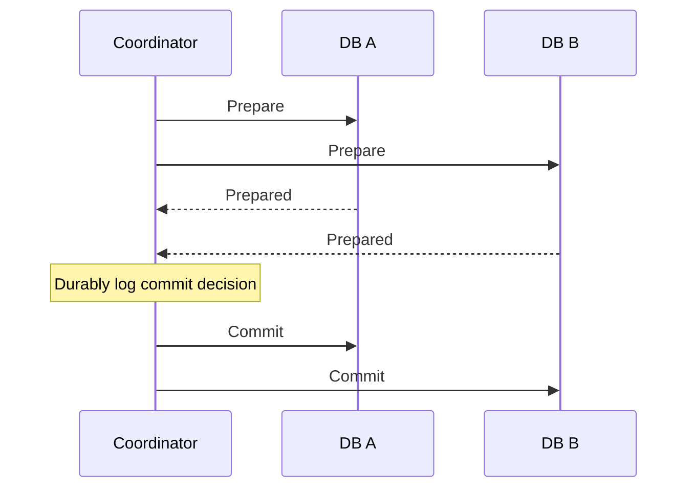

# От ACID к распределённому процессу

Где заканчивается одна транзакция

---

# Что обещает ACID

- **A · Atomicity** — все изменения транзакции или ни одного
- **C · Consistency** — сохраняются заданные инварианты
- **I · Isolation** — видимость конкурентных изменений зависит от isolation level
- **D · Durability** — изменения после commit переживают сбой

---
layout: diagram
---

# 2PC: сначала prepare, потом решение

::caption::
Все prepared → commit. Отказ участника до решения → abort.

---

# Минусы 2PC

- Prepared-транзакция удерживает ресурсы, часто блокировки внутри БД
- Long-running транзакция увеличивает гонки за данными и стоимость отката
- Требует единой технлогии
- Не распространяется на внешние системы
- 2PC полезен, когда участники и длительность контролируемы

---

# Внешний API не обязан поддерживать prepare из 2PC

- Платёжная система предоставляет свои операции
- Проверка возможности оплаты — бизнес-резерв, а не фаза 2PC
- HTTP timeout не доказывает отсутствие эффекта

---

# Локальный commit уже произошёл

- Inventory сделал commit резерва в своей базе
- Order ещё не знает, завершится ли весь заказ
- Rollback транзакции в Order не меняет базу Inventory
- Общий результат требует отдельного протокола
