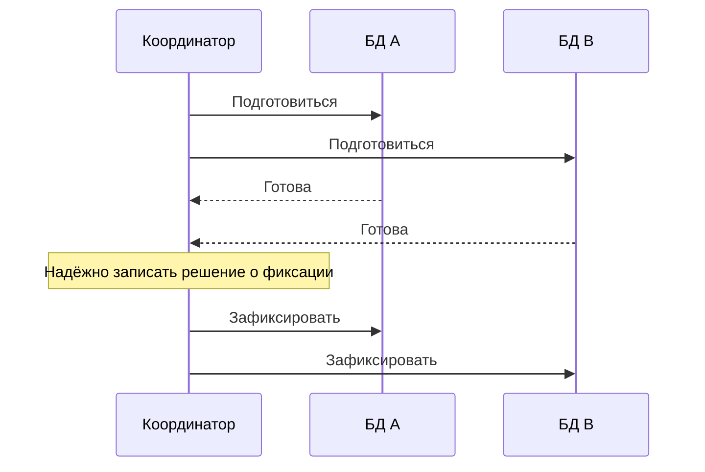

# От ACID к распределённому процессу

8 минут · Где заканчивается одна транзакция

<!--
Время: 0:30. Раздел 1: 8:00 суммарно.
Объяснение: сегодня разбираем заказ, который проходит через несколько сервисов. Сначала отделим гарантии одной БД от гарантий всего бизнес-процесса. Saga не заменяет локальные транзакции: она строится поверх них.
Вопрос аудитории: если два сервиса используют одну СУБД, обязательно ли у них одна транзакция?
Ожидаемый ответ: нет; важна общая транзакционная граница, а не марка СУБД или физический сервер.
-->

---

# Что обещает ACID

- **A · Атомарность** — все изменения транзакции или ни одного
- **C · Согласованность** — сохраняются заданные инварианты
- **I · Изоляция** — видимость конкурентных изменений по уровню изоляции
- **D · Долговечность** — зафиксированные изменения переживают сбой

<!--
Время: 1:30. Накопительно: 2:00 из 8:00.
Объяснение: пример локального инварианта Inventory — доступное количество не уходит ниже нуля. Ограничения БД, блокировки и логика приложения должны совместно его обеспечивать. Буква C не означает, что СУБД сама знает бизнес-правила или согласует другие сервисы.
Изоляция не равна обещанию «транзакции никогда не влияют друг на друга». Гарантии зависят от выбранного уровня; serializable сильнее read committed. Долговечность рассматриваем в рамках настроек и модели отказов конкретной БД.
Вопрос: достаточно ли ACID в Order, чтобы гарантировать резерв в Inventory?
Ответ: нет, изменения другой базы не входят в эту локальную транзакцию.
-->

---
layout: diagram
---

# 2PC: сначала подготовка, потом решение

::caption::
Все готовы → фиксация. Отказ участника до решения → откат.

<!--
Время: 1:30. Накопительно: 3:30 из 8:00.
Объяснение: двухфазная фиксация согласует единый исход транзакции между участниками. В prepare участник проверяет возможность фиксации и надёжно сохраняет подготовленное состояние. После YES он не может просто забыть транзакцию или сам решить её откатить: нужно узнать общее решение.
Вторая фаза — рассылка надёжно записанного решения. Ответы и сообщения могут задерживаться; протокол требует восстановления и повторной доставки решения. Если решение commit уже зафиксировано, потеря ответа не превращает его в abort.
Вопрос: после первого YES координатор уже может отправить COMMIT?
Ответ: нет, требуется готовность всех участников; отказ до принятия решения ведёт к abort.
Источник для преподавателя: PostgreSQL, PREPARE TRANSACTION — https://www.postgresql.org/docs/current/sql-prepare-transaction.html
-->

---

# Цена ожидания общего решения

- Подготовленная транзакция удерживает ресурсы, часто блокировки
- Недоступно решение → участник может остаться в ожидании
- Долгая транзакция увеличивает конкуренцию и стоимость восстановления
- 2PC полезен, когда участники и длительность контролируемы

<!--
Время: 1:30. Накопительно: 5:00 из 8:00.
Объяснение: классический 2PC может блокироваться при потере доступа к решению координатора. Это не обязательно останавливает всю БД, но затронутые ресурсы могут оставаться недоступными другим операциям. У транзакций, которые длятся минуты, проблемы конкуренции заметнее, чем у коротких операций внутри дата-центра.
Не противопоставлять «плохой 2PC» и «хорошую Saga»: у них разные гарантии и ограничения. 2PC уместен при поддержке участников и приемлемой цене координации. Репликация координатора повышает устойчивость, но не делает сетевые разделения бесплатными.
Отдельно проговорить: 2PC — протокол атомарного commit, он сам по себе не задаёт уровень глобальной изоляции. Для изоляции нужны соответствующие механизмы управления конкурентным доступом.
Вопрос: атомарный исход автоматически означает serializable?
Ответ: нет, атомарность и изоляция — разные свойства.
-->

---

# Внешний API не обязан поддерживать подготовку 2PC

- Платёжный провайдер предоставляет свои операции
- Авторизация платежа — бизнес-резерв, а не фаза 2PC
- Истечение времени ожидания HTTP не доказывает отсутствие эффекта
- Вызов API не становится атомарным от обёртки в транзакцию БД

<!--
Время: 1:00. Накопительно: 6:00 из 8:00.
Объяснение: в нашем сценарии Payment авторизует сумму, но не списывает её через capture. Даже если провайдер умеет authorize и void, это не означает поддержку PREPARE/COMMIT общей транзакции. Между этими операциями остаются сетевые сбои и промежуточные бизнес-состояния.
Пример: провайдер создал авторизацию, но ответ потерялся. Откат локальной БД не отменяет эту авторизацию. Нужны проверка статуса и безопасный повтор с тем же ключом идемпотентности, а не предположение об отказе.
Вопрос: что известно после timeout?
Ответ: неизвестен исход операции; он мог быть успешным. Это не основание немедленно освобождать все ресурсы.
-->

---

# Локальная фиксация уже произошла

- Склад зафиксировал резерв в своей базе
- Сервис «Заказы» ещё не знает, завершится ли весь заказ
- Откат транзакции сервиса «Заказы» не меняет базу склада
- Общий результат требует отдельного протокола

<!--
Время: 1:00. Накопительно: 7:00 из 8:00.
Объяснение: проведите на доске две транзакционные границы. В первой Inventory уменьшает доступный остаток и фиксирует резерв. Во второй Order обновляет свой заказ. Если вторая операция не состоялась, первую нельзя отменить командой ROLLBACK из другого соединения, тем более из другой базы.
Промежуток между локальными commit существует даже без аварий. В нём другие запросы уже могут видеть резерв, а заказ ещё остаётся Pending. Поэтому вопрос не только в обработке ошибок, но и в допустимости промежуточных состояний.
Вопрос: помогает ли просто ещё раз отправить весь заказ с новым идентификатором?
Ответ: нет, можно создать дубли резервов и платежей; нужен управляемый процесс с идентичностью операции.
-->

---

# Какую согласованность мы проектируем

- Локальные инварианты защищаем локальной транзакцией
- Межсервисные правила задаём для всего процесса
- Промежуточные состояния делаем явными
- Ошибки завершаем восстановлением, не «общим откатом»

<!--
Время: 1:00. Накопительно: 8:00 из 8:00.
Объяснение: сформулируйте цель будущего процесса: Confirmed допустим только при резерве товара, активной авторизации и бронировании доставки. Cancelled допустим после завершения необходимых компенсаций. Пока финал не достигнут, заказ не следует показывать как безусловно завершённый.
Мы сохраняем ACID внутри каждого сервиса, но больше не обещаем мгновенного «всё или ничего» для четырёх баз. В следующем разделе проверим это на конкретных сбоях заказа.
Вопрос: является ли Pending ошибкой данных?
Ответ: нет, это честное бизнес-состояние незавершённого процесса. Ошибка — считать его финальным или не иметь пути восстановления.
-->
