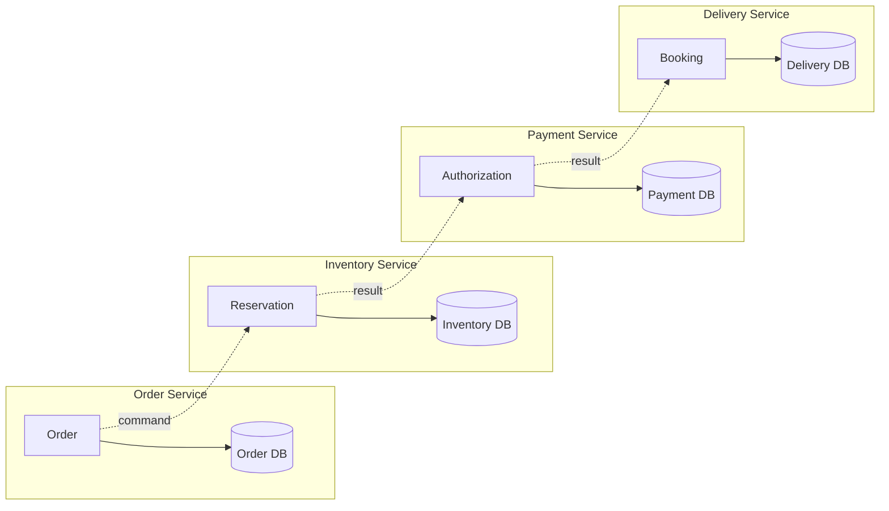
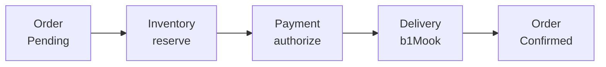
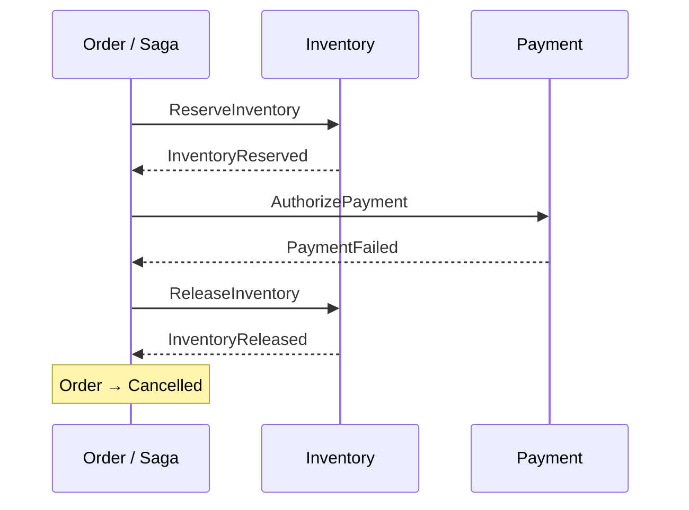
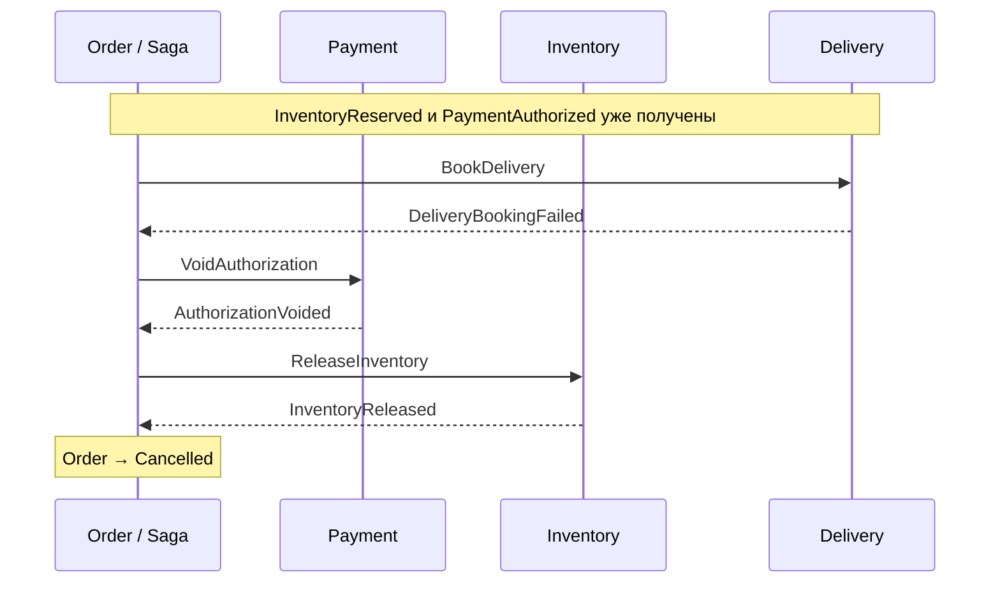

# История одного заказа

Разбираем успешный путь и два отказа

---
layout: diagram
---

# Каждый сервис владеет своей базой

---
layout: diagram
---

# Happy path: ресурсы → заказ Confirmed

::caption::
Каждый результат подтверждён

---
layout: diagram
---

# PaymentFailed после резерва

::caption::
PaymentFailed — достоверный отказ authorization, а не timeout.

---
layout: diagram
---

# DeliveryBookingFailed после authorization

::caption::
Сначала VoidAuthorization, затем ReleaseInventory; Cancelled — после обоих.

---

# Какие особенности

- Timeout не равен отказу платежа или доставки
- До выяснения исхода заказ остаётся Pending
- Внутри БД откатываются только локальные изменения

