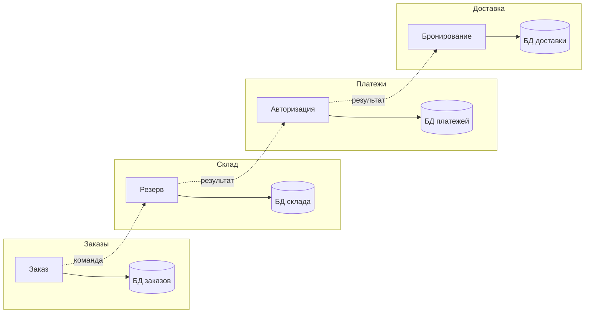
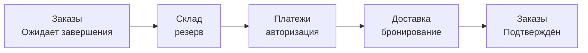
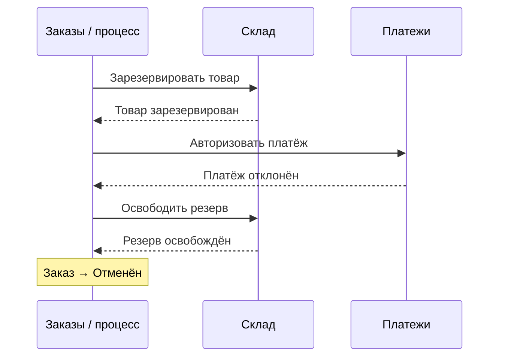
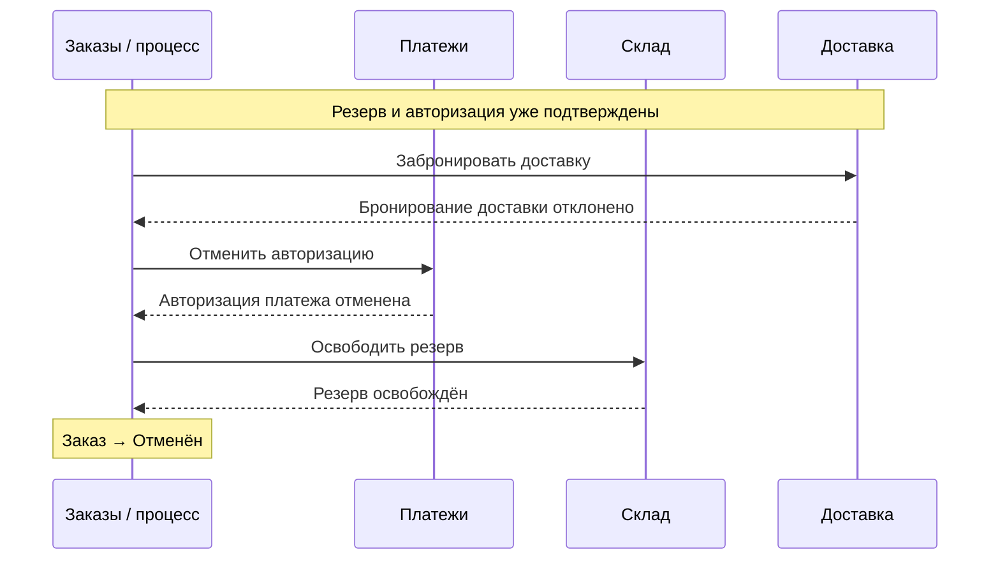

# Один заказ, четыре владельца данных

10 минут · Разбираем успешный путь и два отказа

<!--
Время: 0:30. Раздел 2: 10:00 суммарно.
Объяснение: фиксируем единый пример на всю лекцию. Order создаёт Pending, Inventory резервирует товар, Payment авторизует сумму, Delivery бронирует доставку. Только после этого Order становится Confirmed. Capture платежа и физическая отправка не входят в этот процесс.
Вопрос: авторизация уже означает списание денег?
Ответ: нет; это резервирование суммы, которое в нашем процессе отменяется операцией void.
-->

---
layout: diagram
---

# Каждый сервис владеет своей базой

::caption::
Четыре локальные транзакционные границы, не одна общая.

<!--
Время: 1:30. Накопительно: 2:00 из 10:00.
Объяснение: стрелки показывают логическую последовательность взаимодействий, а не выбранную реализацию координации. В дальнейшем сравним оркестрацию и хореографию. Ни один сервис не пишет напрямую в чужую базу.
Order владеет статусом заказа; Inventory — доступностью и резервами; Payment — состоянием платёжной операции; Delivery — состоянием бронирования. Это четыре разных локальных источника истины.
Внешний платёжный эффект не атомарен с Payment DB. Намерение выполнить операцию сохраняют локально, затем обращаются к провайдеру; неизвестный исход восстанавливают по устойчивому идентификатору операции. То же относится к внешнему API доставки.
Вопрос: кто имеет право просто удалить чужой резерв SQL-запросом?
Ответ: никто из остальных сервисов; изменение проходит через контракт Inventory.
-->

---
layout: diagram
---

# Успешный путь: ресурсы → заказ подтверждён

::caption::
Каждый результат подтверждён; глобальной транзакции нет.

<!--
Время: 1:30. Накопительно: 3:30 из 10:00.
Объяснение: Order сначала надёжно создаёт Pending. Затем подтверждаются резерв, авторизация и бронирование. Лишь подтверждённые результаты дают основание перевести заказ в Confirmed. Авторизация — не capture, бронирование — не физическая доставка.
Если фиксируем состояние процесса и намерение отправить следующую команду, делаем это одной локальной транзакцией через outbox. Сам HTTP-вызов или отправка в брокер не находятся внутри общей DB-транзакции с внешним участником. Механика outbox будет разобрана отдельно.
Сообщение об успешном факте формулируем в прошедшем времени: InventoryReserved, PaymentAuthorized, DeliveryBooked. Команды формулируем как действие: ReserveInventory, AuthorizePayment, BookDelivery.
Вопрос: когда можно показать пользователю окончательное подтверждение?
Ответ: после подтверждения всех трёх ресурсов и фиксации Confirmed в Order, не после одного успешного платежа.
-->

---
layout: diagram
---

# Платёж отклонён после резерва

::caption::
«Платёж отклонён» — достоверный отказ авторизации, а не истечение времени ожидания.

<!--
Время: 2:00. Накопительно: 5:30 из 10:00.
Объяснение: изображён логический процесс, необязательно исполняемый внутри сервиса Order. После InventoryReserved запас уже изменён и commit завершён. PaymentFailed в этом примере означает окончательно отклонённую авторизацию без созданного платёжного резерва.
Поэтому компенсация здесь одна: ReleaseInventory. Пока нет подтверждения InventoryReleased, заказ остаётся в промежуточном состоянии, например Compensating. Отправленная команда ещё не означает выполненное освобождение. Только после его подтверждения фиксируем Cancelled.
Если ответ на ReleaseInventory потерялся, освобождение тоже могло выполниться. Компенсация должна быть идемпотентной, а её результат — проверяемым. К её надёжности применяются те же требования, что и к прямому шагу.
Вопрос: нужно ли здесь делать VoidAuthorization?
Ответ: нет, при достоверном отказе авторизация не создана. При неизвестном исходе сначала нужно выяснить, существовала ли она.
-->

---
layout: diagram
---

# Доставка отказала после авторизации

::caption::
Сначала отмена авторизации, затем освобождение резерва; «Отменён» — после обоих.

<!--
Время: 2:00. Накопительно: 7:30 из 10:00.
Объяснение: DeliveryBookingFailed здесь гарантирует, что бронирования нет. В успешном префиксе процесса есть резерв Inventory и авторизация Payment, поэтому нужны две компенсации в обратном порядке: VoidAuthorization и ReleaseInventory.
Если void временно недоступен, процесс не становится Cancelled и не забывает задолженность по компенсации. Он остаётся Compensating и продолжает восстановление. Порядок задан для нашего сценария; в другой предметной области зависимости могут потребовать другого порядка.
Если бронирование реально существует, а потерялся лишь ответ, эта ветка не подходит: сначала проверяем статус бронирования. При выбранном бизнес-решении отменить подтверждённое бронирование потребуется отдельная компенсация CancelDeliveryBooking.
Вопрос: почему не RefundPayment?
Ответ: capture не было. Void снимает авторизационный резерв; refund возвращает уже списанные деньги и относится к другому бизнес-сценарию.
-->

---

# Нет ответа — нет знания об исходе

- Истечение времени ожидания не равно отказу платежа или доставки
- Сначала запрашиваем статус той же операции
- Безопасный повтор использует тот же ключ идемпотентности
- До выяснения исхода заказ остаётся промежуточным

<!--
Время: 1:30. Накопительно: 9:00 из 10:00.
Объяснение: нарисуйте потерянную обратную стрелку после успешного бронирования. Сервис мог выполнить действие, а процесс этого не знает. Немедленный запуск компенсаций уже известных ресурсов способен оставить активную доставку без товара или платёжного обеспечения.
Reconciliation означает сверку наблюдаемого состояния с намерением процесса. Используем идентификатор операции у провайдера, запрос статуса или повтор с тем же idempotency key, если контракт API это поддерживает. Новый ключ для того же логического действия может создать второй эффект.
Если надёжно определить исход пока нельзя, продолжаем восстановление или передаём случай на контролируемое ручное разрешение. Нельзя выдумывать успешный или неуспешный исход ради красивого финального статуса.
Вопрос: после timeout можно ли повторить BookDelivery с новым ключом?
Ответ: нельзя считать это безопасным повтором: получится другая операция и возможен второй booking.
-->

---

# Как отменить уже зафиксированное?

- Откат доступен только незавершённой транзакции
- Компенсация — новая команда владельцу ресурса
- Её выполнение тоже может задержаться или завершиться ошибкой
- Нужны память процесса и правила восстановления

<!--
Время: 1:00. Накопительно: 10:00 из 10:00.
Объяснение: сделайте паузу и попросите аудиторию предложить решение до введения формального определения Saga. Соберите варианты «удалить запись», «послать обратную команду», «повторить всё». Обсудите, почему только бизнес-владелец знает, как корректно освободить ресурс.
Компенсация сохраняет историю: резерв существовал и затем был освобождён. Она не стирает факт промежуточного состояния и не отменяет действия других клиентов, которые его наблюдали.
Вопрос: почему списка обратных HTTP-вызовов в памяти недостаточно?
Ответ: процесс может упасть между шагами; должны сохраниться подтверждённые результаты и намерения следующих действий. Это подводит к Saga как восстанавливаемому процессу, а не только циклу с обработчиком ошибок.
-->
