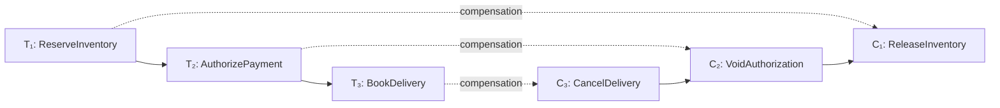

# Saga

Что гарантируем вместо общей транзакции

---

# Что такое Saga

- **Saga** — бизнес-процесс из последовательности локальных транзакций T₁…Tₙ
- Каждая Tᵢ выполняется в своём сервисе и коммитится сразу
- У каждого шага с эффектом есть **compensating transaction** Cᵢ
- При отказе компенсируем уже выполненные шаги в обратном порядке

---
layout: diagram
---

# T₁, T₂, T₃ и compensating transactions

::caption::
T₃ достоверно отказал → C₂ → C₁. Успешного T₃ нет — C₃ не нужен.

---

# Compensation — не rollback транзакции

- Это **новый локальный бизнес-процесс**, а не отмена старого коммита
- Она восстанавливает бизнес-инвариант, не БД
- История и наблюдавшие её клиенты никуда не исчезают
- Компенсация требует идемпотентности и восстановления

**Примеры компенсаций**

- `ReleaseInventory` — вернуть товар в доступный остаток
- `VoidAuthorization` — снять резерв суммы
- `CancelDelivery` — отменить бронь курьера
- `CancelOrder` — перевести заказ в Cancelled

---

# Не всё имеет точную обратную операцию

Важно понимать, что можно вернуть **"взад"**

- Письмо нельзя «разотправить»: можно отправить уточнение
- Бронь доставки можно отменить; вручённую посылку — нет
- **Refund** возвращает списанные деньги: сроки и комиссии остаются

---

# Что мешает довести процесс до согласованного финала

- **Нет изоляции** — промежуточные состояния видны другим процессам
- **Неизвестный исход** — timeout не говорит, был ли эффект
- **Повторы** — retries и redelivery не должны дублировать эффект
- **Dual write** — commit в БД и публикация события не атомарны
- **Падение процесса** — после рестарта нужно продолжить с того же шага
- **Сбой компенсации** — отмену тоже нужно довести до конца

---

# Кто ведёт Saga?

Каждый шаг Saga должен знать, что делать дальше: продолжать или компенсировать.

Проблемы с прошлого слайда остаются при любой реализации Saga. **Каждый конкретный бизнес-сценарий должен решать их самостоятельно**

--- 

# Различие от 2PC

- **2PC** - бизнес-процесс максимально простой, откат на уровне БД
- **Saga** - бизнес-процесс имеет состояние: он может быть отменен или реконсилирован

---

# Reconciling и Compensating

Saga хранит не только итог, но и незавершённые состояния:

- **Reconciling** — исход шага неизвестен, например после timeout. Сначала узнаём у участника, был ли эффект, и только потом продолжаем или компенсируем
    - При ошибке резерва оплаты, перед повтором или отменой должны проверить зарезервированы средства уже
- **Compensating** — решение об отмене принято. Compensations выполняются, пока все сделанные шаги не будут отменены
- Только после этого Saga переходит в финальное состояние: **Confirmed** или **Cancelled**

---

# Виды Saga

**Choreography**

- Сервисы обмениваются событиями
- Общего координатора нет

**Orchestration**

- Orchestrator отправляет команды участникам
- Это может быть внутри сервиса (Order) или выделенный сервис под определнный сценарий

