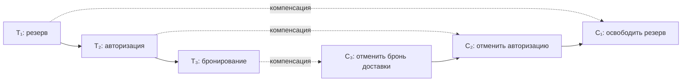

# Saga: процесс и его компенсации

15 минут · Что гарантируем вместо общей транзакции

<!--
Время: 0:30. Раздел 3: 15:00 суммарно.
Объяснение: теперь дадим имя процессу из предыдущего раздела. Saga — последовательность локально фиксируемых шагов с правилами восстановления. Не каждый бизнес-эффект имеет точную обратную операцию, поэтому дизайн компенсаций начинается с предметной области, а не с библиотеки.
Вопрос: исчезают ли локальные ACID-транзакции при переходе к Saga?
Ответ: нет; они обеспечивают надёжность отдельных шагов, а Saga координирует общий процесс.
Источник для преподавателя: Garcia-Molina, Salem, Sagas (1987), https://www.cs.cornell.edu/andru/cs711/2002fa/reading/sagas.pdf
-->

---
layout: diagram
---

# T₁, T₂, T₃ и бизнес-компенсации

::caption::
T₃ достоверно отказал → C₂ → C₁. Успешного T₃ нет — C₃ не нужен.

<!--
Время: 2:00. Накопительно: 2:30 из 15:00.
Объяснение: T обозначает логический шаг с локально зафиксированным результатом. T1 резервирует товар, T2 подтверждает авторизацию, T3 подтверждает бронирование. Для внешнего API шаг содержит сохранение намерения, внешний вызов и фиксацию результата, а не одну DB-транзакцию вокруг HTTP. Создание Order Pending и финальная смена статуса обрамляют эту схему.
Каждому компенсируемому успешному шагу сопоставляем бизнес-компенсацию. В нашем примере отменяем успешный префикс в обратном порядке. Если T2 достоверно отказал, выполняется только C1. Если T3 достоверно отказал — C2, затем C1. Если отменяем процесс, где T3 уже успешно забронировал доставку, сначала нужен C3, пока отмена бронирования допускается бизнесом.
Компенсации не запускаются просто потому, что они нарисованы: для каждой должно существовать подтверждённое действие, которое требуется компенсировать. Стрелки вниз показывают соответствие, а не неизбежный переход после успеха.
Вопрос: нужно ли компенсировать неуспешный T3?
Ответ: при достоверном отказе без эффекта — нет. Если исход неизвестен или эффект частичный, сначала выясняем состояние и обязательства по контракту шага.
-->

---

# Компенсация — не откат транзакции

- Это **новая локальная транзакция**, а не отмена старой фиксации
- Она восстанавливает бизнес-инвариант, не прошлый снимок БД
- История и наблюдавшие её клиенты никуда не исчезают
- Компенсация требует идемпотентности и восстановления

<!--
Время: 2:00. Накопительно: 4:30 из 15:00.
Объяснение: Inventory не возвращает всю таблицу остатков к состоянию до резерва. За прошедшее время другие клиенты могли приобрести товар. Он переводит конкретный резерв в Released и возвращает именно принадлежащее этому резерву количество, одной локальной транзакцией.
Повтор ReleaseInventory для уже освобождённого резерва не должен второй раз увеличивать доступный остаток. Поэтому идентичность бизнес-операции и проверка перехода состояния важнее механического «выполнить обратное арифметическое действие».
Компенсация может иметь собственные ограничения и ошибки. Пока она не завершена, Saga хранит обязательство её выполнить; запись ошибки в лог не равна выполненной компенсации. Результат фиксируется вместе с намерением следующего сообщения через локальный outbox.
Вопрос: почему нельзя восстановить старое значение available из сохранённого снимка?
Ответ: это затрёт изменения других транзакций. Компенсация затрагивает конкретное бизнес-действие, а не всю историю после него.
-->

---

# Не всё имеет точную обратную операцию

- Письмо нельзя «разотправить»: можно отправить уточнение
- Бронь доставки можно отменить; вручённую посылку — нет
- **Отмена авторизации** снимает резерв суммы до списания
- **Возврат списанного** возвращает деньги: сроки и комиссии остаются

<!--
Время: 2:00. Накопительно: 6:30 из 15:00.
Объяснение: компенсация стремится к приемлемому бизнес-результату, а не к физическому стиранию прошлого. Получатель уже мог прочитать письмо; возврат посылки — отдельный процесс; refund может идти несколько дней и не возвращать все комиссии.
В нашей Saga capture отсутствует, поэтому C2 именно VoidAuthorization. Не подменяем его refund ради привычного примера. У авторизации есть срок действия и условия отмены: подтверждение и последующее исполнение заказа должны учитывать контракт провайдера.
Необратимые действия по возможности располагают после обратимых проверок и резервов. Если необратимый шаг всё же совершён, стратегия восстановления может требовать завершить оставшуюся часть процесса или запустить отдельную процедуру урегулирования. Нельзя обещать универсальную функцию undo для любого API.
Вопрос: уведомление «заказ подтверждён» безопасно отправлять до Confirmed?
Ответ: нет; сначала фиксируем бизнес-решение. Доставка самого уведомления остаётся отдельным надёжным действием, но не должна сообщать несуществующий финал.
-->

---

# Восстановление вперёд: продолжить к цели

- Временная ошибка → повторяем тот же логический шаг
- Неизвестный исход → сверяем состояние, затем решаем
- Успех найден → сохраняем результат и продолжаем
- Новый запрос не должен создавать новый бизнес-эффект

<!--
Время: 2:00. Накопительно: 8:30 из 15:00.
Объяснение: forward recovery означает попытку завершить намеченный процесс, а не просто двигаться к следующему шагу без проверки. Пример: Delivery временно недоступен, но резерв и авторизация ещё действительны. Повторяем BookDelivery согласно контракту и бизнес-дедлайну.
При timeout сперва выясняем исход по устойчивому идентификатору. Если операция уже выполнена, принимаем сохранённый результат. Если контракт допускает безопасный повтор, используем тот же idempotency key. Транспортных попыток может быть несколько, логическая операция остаётся одной.
Если ресурс имеет срок действия, перед продолжением нельзя предполагать, что старый успех всё ещё достаточен. Например, истёкшая авторизация не позволяет безусловно перейти в Confirmed. Решение о продолжении или отмене определяется состоянием ресурсов и бизнес-правилами.
Вопрос: Payment вернул достоверный отказ банка; поможет ли бесконечный технический retry?
Ответ: это не временный транспортный сбой. Нужна бизнес-ветка отказа либо отдельное явно разрешённое действие пользователя, а не повтор старой операции без оснований.
-->

---

# Восстановление назад: завершить компенсации

- Достоверный бизнес-отказ → отменяем успешный префикс
- Для отказа доставки: отмена авторизации → освобождение резерва
- Ошибка компенсации → сохраняем состояние и восстанавливаем
- «Отменён» только после подтверждённых компенсаций

<!--
Время: 2:00. Накопительно: 10:30 из 15:00.
Объяснение: backward recovery — выполнение компенсирующих бизнес-действий, а не возвращение указателя программы назад. После подтверждённого отказа Delivery зафиксированы T1 и T2. Сохраняем решение об отмене и намерение VoidAuthorization; после подтверждения void планируем ReleaseInventory.
Если сервис Payment недоступен, Saga находится в Compensating. При восстановлении процесса нужно знать, на каком действии остановились, а не начинать вслепую. Если ответ на компенсацию потерян, также выполняем сверку или идемпотентный повтор.
Ошибки, неразрешимые автоматически, требуют контролируемого ручного разрешения с сохранением истории и повторным подтверждением инвариантов. До этого процесс не объявляет себя Cancelled. Ручное вмешательство — способ завершить обязательства, а не просто стереть красный статус.
Вопрос: команда ReleaseInventory записана в outbox. Можно уже ставить Cancelled?
Ответ: нет, запись намерения гарантирует возможность доставки команды, но не факт выполнения компенсации. Нужен подтверждённый результат.
-->

---

# Согласованность в конечном счёте — не глобальный ACID

- Промежуточные результаты видны другим процессам
- Нет глобальной атомарности и автоматической изоляции
- Сходимость требует доставки, повторов и успешного восстановления
- Зависшая Saga — незавершённое обязательство, не согласованный финал

<!--
Время: 2:00. Накопительно: 12:30 из 15:00.
Объяснение: в отличие от одной общей ACID-транзакции, у Saga локальные commit становятся видимыми до завершения всего процесса. Компенсация меняет бизнес-состояние позже; она не делает промежуточные наблюдения несуществующими.
Пример аномалии: другой процесс видит авторизацию и начинает отправку, хотя Delivery ещё может отказать. Локальная корректность Payment не защищает межсервисное правило «отправлять только подтверждённый заказ». Нужны явные состояния и ограничения разрешённых действий.
Eventual consistency в контексте Saga — ожидаемое достижение согласованного бизнес-исхода при выполнении предпосылок восстановления. Это не автоматическая гарантия за фиксированное время и не обещание, что любой неизлечимый сбой исчезнет сам. Бессрочно недоступный провайдер или невыполненная компенсация мешают завершению.
Вопрос: можно ли сказать, что Saga обеспечивает ту же атомарность, только медленнее?
Ответ: нет. Промежуточные эффекты наблюдаемы, а компенсация семантическая; полного эквивалента глобального rollback нет.
-->

---

# Защитные бизнес-состояния

- **Ожидает завершения** — заказ есть; исполнение ещё запрещено
- **Сверка результата** — исход шага неизвестен; сначала сверка
- **Компенсация** — отмена начата, обязательства ещё остались
- **Подтверждён** — все ресурсы подтверждены и действительны
- **Отменён** — необходимые компенсации завершены

<!--
Время: 2:30. Накопительно: 15:00 из 15:00.
Объяснение: это пример доменных состояний, не обязательные названия из стандарта Saga. Pending и промежуточные состояния не дают права на физическую отправку. Reconciling хранит конкретный неизвестный шаг и его идентификатор; Compensating хранит прогресс обратных действий. Одной строки общего статуса недостаточно, чтобы восстановить весь процесс.
Переходы проверяются атомарно в локальной базе владельца состояния. Проверка версии или ожидаемого состояния помогает не принять запоздалый успех как разрешение перейти из Compensating в Confirmed. Поздний результат нельзя просто выбросить, если за ним стоит внешний ресурс: его нужно согласовать с уже выбранной веткой процесса.
Резерв Inventory — пример семантической блокировки: доступное количество учитывает активные резервы, а не требует держать DB lock всё время Saga. Такие бизнес-ограничения уменьшают опасные конкурентные взаимодействия, но не создают универсальную глобальную serializable-изоляцию.
Мини-упражнение: PaymentAuthorized пришёл, пока заказ Reconciling. Можно ли сразу Confirmed?
Ответ: нет; нужно сопоставить результат с конкретным шагом, сохранить авторизацию и проверить оставшиеся условия, включая DeliveryBooked. Если уже выбрана отмена, авторизация должна попасть в план компенсаций.
Итог: Saga — это прямые действия, компенсирующие действия, сохранённый прогресс и бизнес-правила переходов. Дальше разбираем, кто именно управляет этим процессом.
-->
