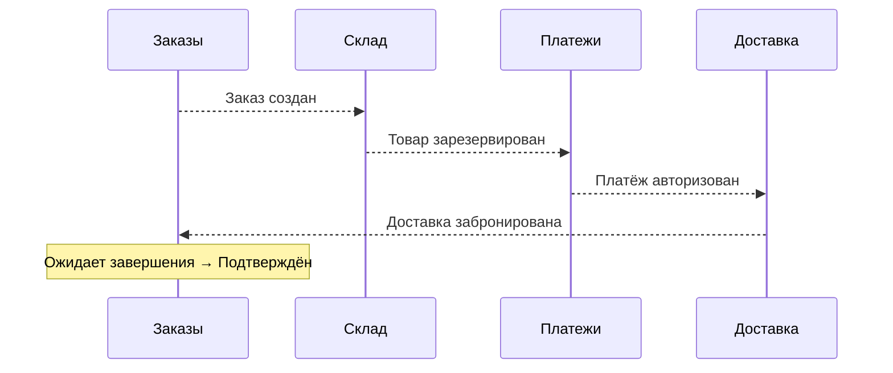
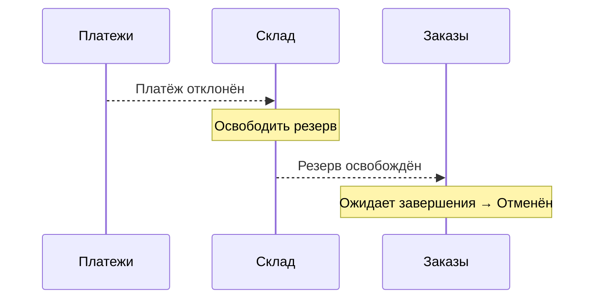
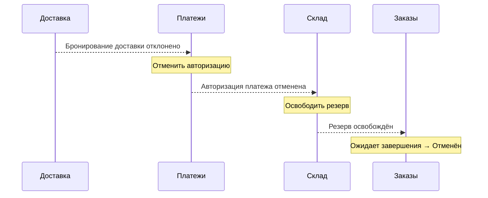

# Хореография

14 минут · процесс складывается из реакций сервисов

<!--
Время: 0:30. Раздел 4: всего 14:00.
Объяснение: теперь применяем Saga к одному заказу, но не вводим выделенный управляющий сервис. Участники знают свои реакции на факты, а не обязательно весь процесс.
Вопрос: отсутствие управляющего означает отсутствие управления? Ответ: нет, правила управления распределены между участниками.
-->

---
layout: diagram
---

# Цепочка событий без дирижёра

::caption::
Событие сообщает о факте; следующий участник сам выбирает реакцию

<!--
Время: 2:00. Накопительно: 2:30 / 14:00.
Объяснение: Order сначала сохраняет Pending и OrderCreated. Inventory резервирует товар; Payment авторизует, но не списывает деньги; Delivery бронирует доставку. Order подтверждает заказ только после DeliveryBooked. Стрелки обозначают логические подписки через брокер, а не прямые синхронные вызовы. Выделенного владельца последовательности нет.
Вопрос: кто приказал Payment авторизовать платёж? Ответ: это локальное правило Payment при получении InventoryReserved, а не команда центрального координатора.
-->

---
layout: diagram
---

# Платёж отклонён: сначала освобождаем резерв

::caption::
«Платёж отклонён» — достоверный отказ авторизации, не истечение времени ожидания

<!--
Время: 2:00. Накопительно: 4:30 / 14:00.
Объяснение: Inventory подписан на PaymentFailed и запускает свою локальную компенсацию ReleaseInventory. Только подтверждённое InventoryReleased позволяет Order перейти в Cancelled. Между отказом и завершением компенсации заказ остаётся незавершённым; для интерфейса можно показывать, что отмена выполняется. PaymentFailed не требует VoidAuthorization: авторизация достоверно не состоялась.
Вопрос: можно ли Order отмениться сразу на PaymentFailed? Ответ: нет, иначе статус обещает завершённую отмену при ещё удерживаемом резерве.
-->

---
layout: diagram
---

# Доставка отклонена: компенсации по цепочке

::caption::
Достоверный отказ доставки → снять авторизацию → снять резерв → отменить заказ

<!--
Время: 2:00. Накопительно: 6:30 / 14:00.
Объяснение: здесь авторизация уже существует, поэтому Payment сначала выполняет VoidAuthorization. Это не refund: capture в нашем сценарии отсутствует. Inventory освобождает резерв после PaymentAuthorizationVoided. Order проверяет, что InventoryReleased относится к активному процессу отмены этого заказа; произвольное событие освобождения не является основанием для отмены. Если компенсация не завершилась, цепочка остаётся незавершённой.
Вопрос: что делать при таймауте VoidAuthorization? Ответ: выяснять его исход или безопасно повторять с тем же ключом, а не публиковать успешное событие заранее.
-->

---

# Автономность требует локальной надёжности

- Каждый сервис меняет только свою базу
- Состояние и исходящее событие → одна транзакция
- Таблица исходящих сообщений обеспечивает доставку после фиксации
- Повторная доставка не повторяет бизнес-эффект

<!--
Время: 2:00. Накопительно: 8:30 / 14:00.
Объяснение: Inventory атомарно сохраняет резерв и InventoryReserved в outbox. Обработку входящего message_id и локальное изменение также связываем транзакцией, где это применимо. Внешний платёжный провайдер не включается в эту DB-транзакцию: Payment сохраняет намерение, выполняет вызов с устойчивым idempotency key и затем фиксирует установленный исход вместе с outbox. Потерянный ответ требует reconciliation. Дедупликация message_id защищает обработку доставки; ключ бизнес-операции защищает внешний эффект.
Вопрос: outbox даёт exactly-once эффект у провайдера? Ответ: нет, он решает атомарность локального состояния и публикации; внешний эффект требует собственного протокола идемпотентности и выяснения исхода.
Источник: https://microservices.io/patterns/data/transactional-outbox.html
-->

---

# Молчание — не отказ

- Истечение времени ожидания означает неизвестный исход операции
- Владелец шага сохраняет предельный срок и состояние
- Сначала сверка результата или повтор с тем же ключом
- Зависшие процессы требуют поиска и эскалации

<!--
Время: 2:00. Накопительно: 10:30 / 14:00.
Объяснение: Payment после таймаута авторизации не публикует PaymentFailed: провайдер мог успешно удержать деньги. Сначала проверяем операцию по её устойчивому идентификатору или повторяем с тем же idempotency key, если провайдер гарантирует такую семантику. Только установленный результат продолжает цепочку. Дедлайны и ожидаемые события хранятся устойчиво, не в таймере одного процесса. Аналогично выясняем исход бронирования доставки. Просроченная Saga попадает в мониторинг и при необходимости на ручное разрешение, а не автоматически в Cancelled.
Вопрос: поздний PaymentAuthorized после таймаута допустим? Ответ: да; его сопоставляют с сохранённой операцией и текущим состоянием, а не воспринимают как новый платёж.
-->

---

# Автономные сервисы, распределённая логика

- Реакции развёртываются независимо
- Нет единого файла бизнес-последовательности
- Изменение события затрагивает подписчиков
- Сквозной сценарий тестируется как система

<!--
Время: 1:30. Накопительно: 12:00 / 14:00.
Объяснение: независимый деплой не равен отсутствию связности. Payment зависит от смысла InventoryReserved, Delivery — от PaymentAuthorized, а путь отмены проходит по другим подпискам. Добавление проверки риска может потребовать изменения нескольких участников. Контрактные тесты помогают совместимости сообщений, но не доказывают корректность всей Saga; нужны сценарии отказов, дублей и перестановок.
Вопрос: можно ли добавить нового независимого подписчика без изменения старых? Ответ: часто да, например аналитику. Вставка обязательного шага перед оплатой меняет бизнес-зависимости и уже не является простым подключением наблюдателя.
-->

---

# Кто знает всю Saga?

- Участник знает свои события и реакции
- Карта процесса показывает весь путь
- Идентификатор выполнения Saga связывает шаги одного процесса
- Идентификаторы сообщения и его причины объясняют доставку и причинную связь

<!--
Время: 2:00. Накопительно: 14:00 / 14:00.
Объяснение: задайте вопрос до разбора пунктов и дайте аудитории 20–30 секунд. В хореографии вся Saga может быть известна только из совокупности контрактов и карты процесса; это нужно сделать явным командным артефактом. Наблюдатель может собирать read model, не становясь управляющим: он не выбирает следующие бизнес-команды. saga_id — идентификатор выполнения процесса; message_id — идентификатор конкретного сообщения, сохраняемый при повторной доставке; causation_id — идентификатор сообщения, вызвавшего текущее. Это разные роли, а не три названия одного UUID.
Вопрос: брокер знает всю Saga? Ответ: нет, брокер маршрутизирует сообщения и не обязан понимать порядок бизнес-шагов или условия завершения. Для диагностики нужны корреляция, сохранённое состояние участников и владелец сквозного процесса.
Источник: https://microservices.io/patterns/data/saga.html
-->
