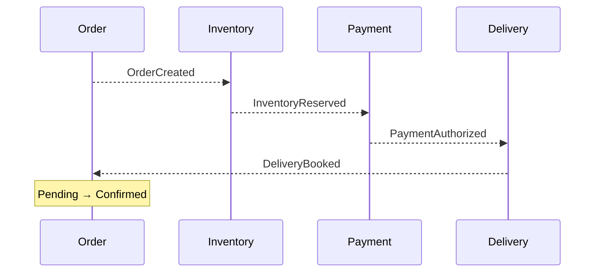
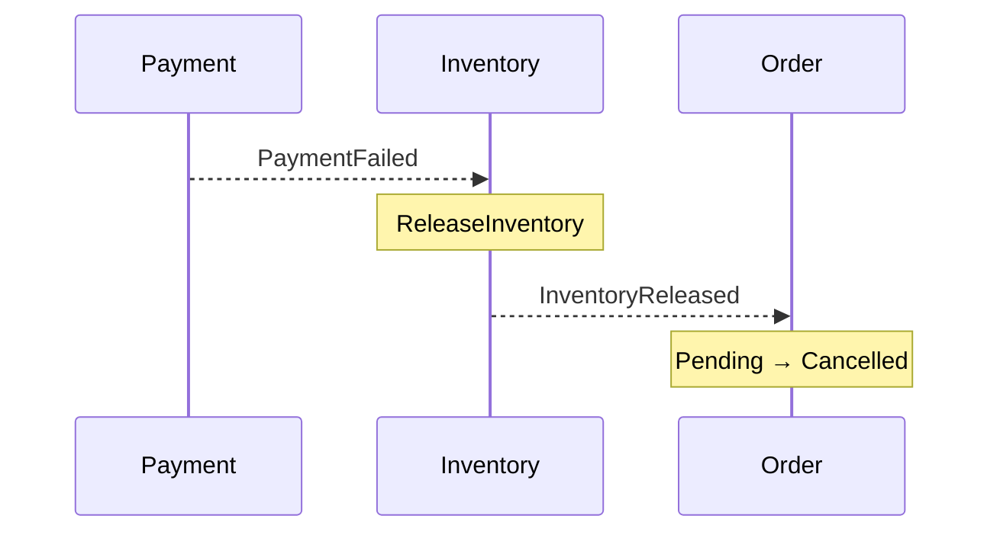
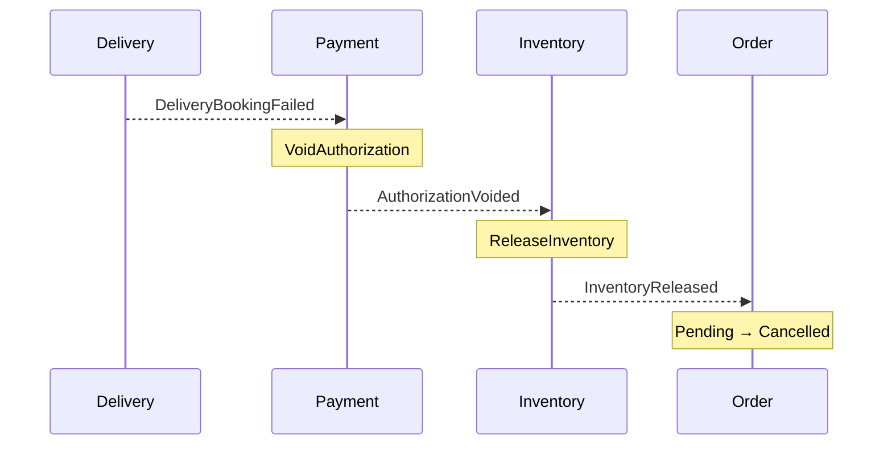
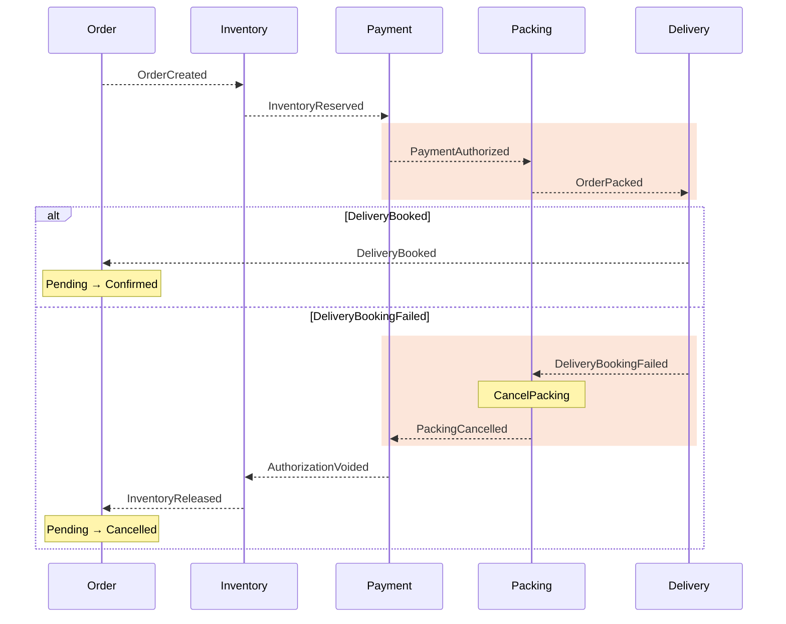
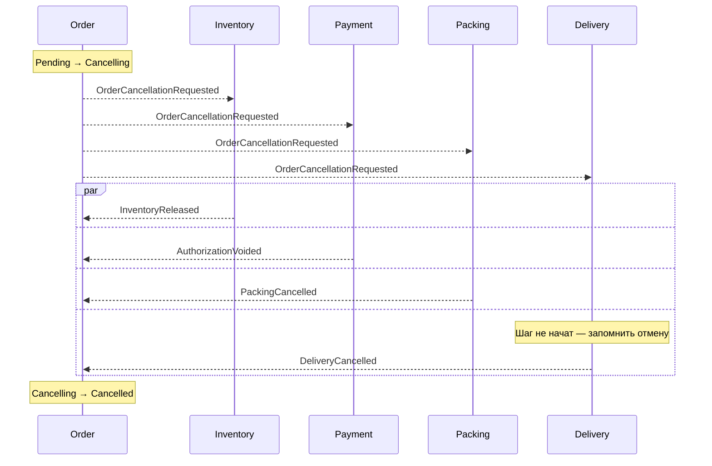

# Choreography

Процесс складывается из реакций сервисов

---
layout: diagram
---

# Цепочка событий без дирижёра

::caption::
Event сообщает о факте; следующий участник сам выбирает реакцию

---

# Event — факт, не команда

- Имя в прошедшем времени: `InventoryReserved`, `PaymentAuthorized`
- Факт уже произошёл у отправителя — получатель не может его отклонить
- Отправитель не знает, кто подписан и что подписчики сделают
- Подписчик сам решает, нужна ли реакция: Payment на `InventoryReserved` выполняет `AuthorizePayment`
- Event несёт данные для реакции: order ID, Saga ID, сумму
- Новая реакция — новый подписчик, отправитель не меняется

---
layout: diagram
---

# PaymentFailed: сначала освобождаем резерв

::caption::
PaymentFailed — достоверный отказ authorization, не timeout

---
layout: diagram
---

# DeliveryBookingFailed: compensations по цепочке

::caption::
DeliveryBookingFailed → VoidAuthorization → ReleaseInventory → Cancelled

---

# Автономность требует локальной надёжности

- Каждый сервис меняет только свою базу
- Состояние и outgoing event → одна транзакция
- Transactional Outbox обеспечивает доставку после commit
- Redelivery события не повторяет бизнес-эффект

---

# Плюсы choreography

- Нет центрального компонента, который нужно разрабатывать и держать надёжным
- Слабая связанность: отправитель не знает своих подписчиков
- Сервисы развёртываются и масштабируются независимо
- Новая реакция на существующий event не требует менять отправителя
- Просто для коротких процессов из 2–4 шагов

---

# Новый участник: Packing перед Delivery

Было: `PaymentAuthorized` → Delivery. Стало: `PaymentAuthorized` → Packing → `OrderPacked` → Delivery

1. Events несут версию процесса: v1 — старая цепочка, v2 — с Packing
2. Delivery реагирует и на `PaymentAuthorized` v1, и на `OrderPacked` v2
3. Deploy Packing: читает `PaymentAuthorized` v2, публикует `OrderPacked`
4. Compensations: Packing слушает `DeliveryBookingFailed`, Payment — отмену упаковки
5. Order начинает Saga v2; поддержку v1 убираем, когда старые Saga завершатся

**Один новый шаг → правки и порядок deploy в нескольких сервисах**

---
layout: diagram
---

# Цепочка events с Packing

::caption::
Выделено то, что изменилось: новый получатель `PaymentAuthorized` и `DeliveryBookingFailed`, новые `OrderPacked` и `PackingCancelled`

---

# Отмена операции пользователем

Покупатель нажал «Отменить», а Saga ещё идёт: резерв есть, оплата, возможно, уже авторизована, Packing в процессе.

**Как здесь провести отмену?**

---

# Отмена: каждый участник реагирует сам

- Order переводит заказ в Cancelling и публикует `OrderCancellationRequested`
- Каждый участник компенсирует свой шаг, если успел его выполнить
- Если шаг ещё не выполнен — запоминает отмену и не выполняет его позже
- Order ждёт подтверждения от всех участников → Cancelled
- После передачи курьеру отменить нельзя — только возврат

---
layout: diagram
---

# Отмена через events

::caption::
Один event получают все участники; Order ждёт подтверждения от каждого

---

# Кто знает всю Saga?

- Участник знает свои events и реакции
- Process map показывает весь путь
- Saga ID (correlation ID) связывает шаги одного процесса
- Message ID и causation ID объясняют доставку и причинную связь

---

# Минусы choreography

- Нет единого файла бизнес-последовательности
- End-to-end сценарий тестируется как вся система
- Stuck-процессы требуют поиска и эскалации
- Стартовый сервис, в некоторых ситуациях должен знать о всех участниках (подтверждение отмены)
