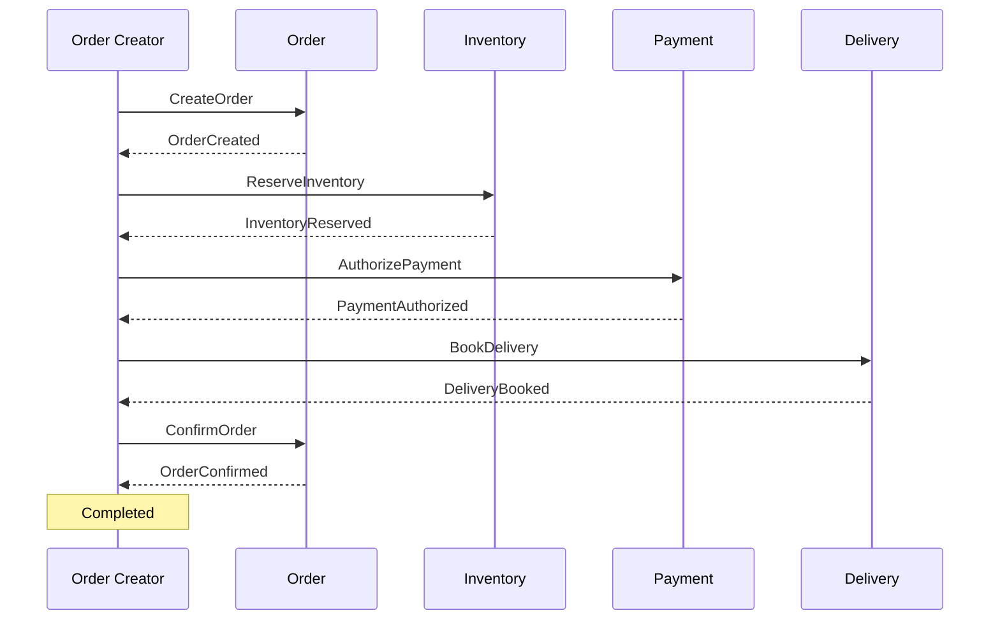
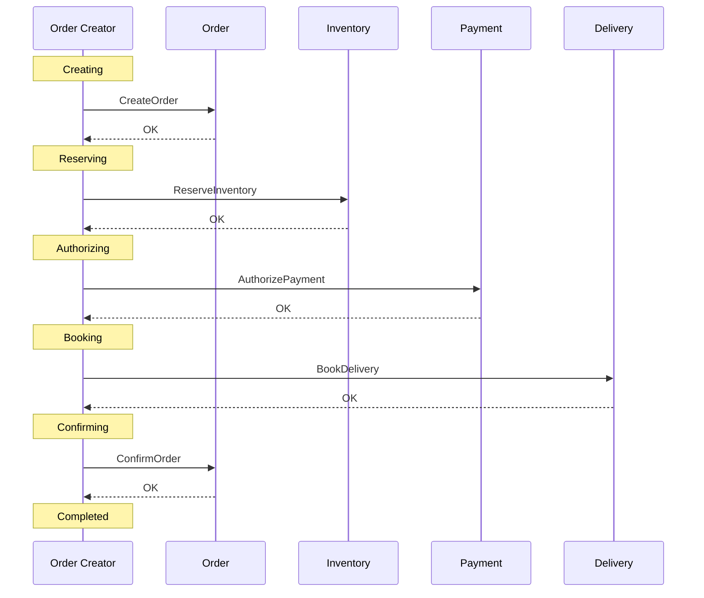
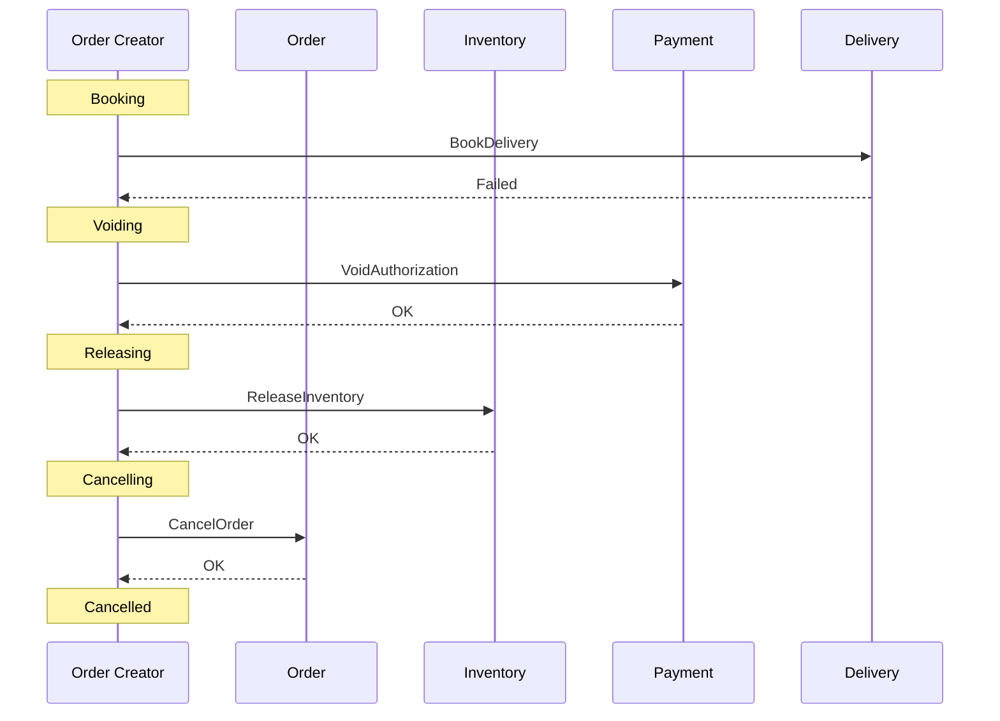
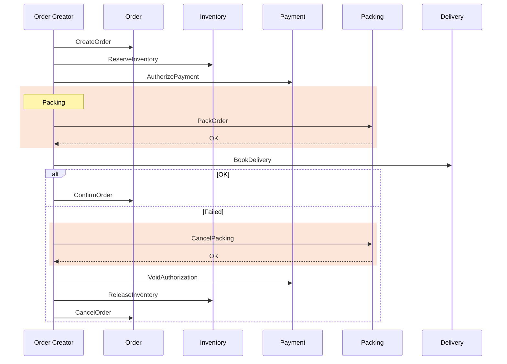
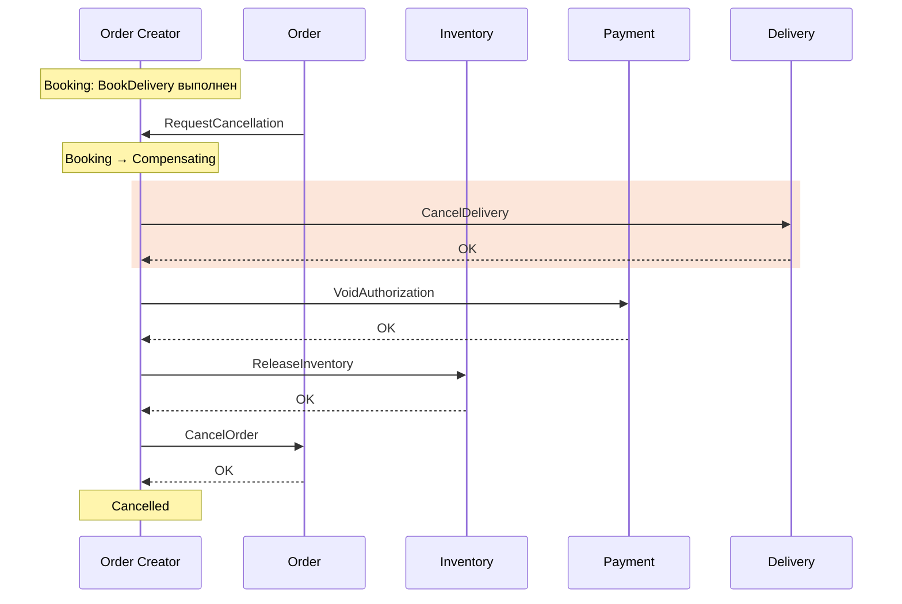

# Orchestration

Явный владелец процесса — Order Creator

---
layout: diagram
---

# Процесс заказа с orchestrator: happy path

--- 

# Процесс = State Machine

* Четкая последовательность переходов
* В сервисе координаторе программируется как чистый бизнесс-процесс

---
layout: diagram
---

# State machine: happy path

---
layout: diagram
---

# State machine: compensation path

::caption::
Отказ AuthorizePayment: Authorizing → Releasing, VoidAuthorization не нужен

---

# Оркестратор

* Персистентное состояние - знает про все шаги и их состояние
* **Должен** выдерживать перезапуск и падения. Иначе просто потеряем весь процесс
* Единая точка отказа всего бизнес-процесса
* Retry, Cancel, Reconcile, Versioning - его ответственность

---

# Почему обработка исключений при HTTP-вызовах — ещё не orchestrator

- Исключение не доказывает отсутствие эффекта
- Crash процесса уничтожает stack и timers
- Retry запроса может повторить всю цепочку
- Нужны сохранённые transitions, исходы и compensations

---
layout: diagram
---

# Новый участник: Packing в orchestration

::caption::
Меняется только Order Creator: новое состояние, command и compensation. Остальные участники о Packing не знают

---

# Versioning бизнес-процесса

- Изменение бизнес-процесса требует **явного versioning** в orchestrator
- Каждая Saga хранит версию процесса, с которой стартовала
- **v1** — без Packing: уже запущенные Saga доходят до конца по старой схеме
- **v2** — с Packing: по ней стартуют только новые Saga
- Compensations тоже по версии: Saga v1 не вызывает `CancelPacking`
- Packing развёрнут до запуска v2; код v1 удаляем, когда все Saga v1 завершились

---
layout: diagram
---

# Отмена операции пользователем в orchestration

::caption::
Отмену получает только Order Creator: по своему состоянию он знает, какие шаги компенсировать

---

# Где располагать логику orchestration

**Внутри Order**

- Order знает детали всех шагов бизнес-процесса
- Order знает всех участников

**Отдельный сервис Order Creator**

- Сервис одного бизнес-сценария
- Обычно дороже в эксплуатации
- Зато бизнес-сценарием можно управлять как отдельным сервисом

---

# Плюсы orchestration

- Весь бизнес-процесс описан в одном месте
- Состояние каждой Saga явное: видно, где она остановилась
- Новый шаг — правка только в orchestrator
- Retry, cancel и reconciliation собраны в одном компоненте
- Участники проще: выполняют command и не знают о процессе

---

# Минусы и сложности orchestration

- Orchestrator — ещё один компонент, который нужно сделать надёжным
- Без orchestrator процесс стоит: нужны persistent state и restart
- Риск «god service»: бизнес-логика участников утекает в orchestrator
- Versioning процесса для уже запущенных Saga
- Durable state, timers и outbox — по сути свой workflow engine
