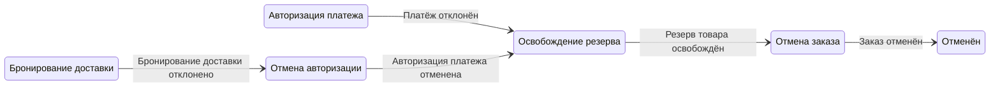

# Оркестрация

15 минут · явный владелец процесса — оркестратор Saga заказа

<!--
Время: 0:30. Раздел 5: всего 15:00.
Объяснение: сохраняем те же сервисы, локальные базы и бизнес-операции. Меняем место, в котором принимается решение о следующем шаге.
Вопрос: оркестратор получает право менять базу Payment? Ответ: нет, он управляет протоколом, а не чужими данными.
-->

---

# Команда просит, событие сообщает

- «Зарезервировать товар» → «Товар зарезервирован»
- «Авторизовать платёж» → «Платёж авторизован»
- «Забронировать доставку» → «Доставка забронирована»
- Оркестратор Saga заказа выбирает следующую команду

<!--
Время: 2:00. Накопительно: 2:30 / 15:00.
Объяснение: команда адресована владельцу операции и выражена повелительным глаголом. Событие — установленный факт в прошедшем времени, включая отказ: PaymentFailed, DeliveryBookingFailed. Оркестратор хранит логику последовательности и компенсаций. Участники по-прежнему проверяют свои бизнес-инварианты и выполняют локальные операции. Команды и результаты несут saga_id; message_id идентифицирует сообщение, causation_id связывает результат с причиной. Эти идентификаторы не заменяют idempotency key внешней операции.
Вопрос: AuthorizePayment означает, что деньги уже авторизованы? Ответ: нет, это запрос. Переход вперёд разрешает только подтверждённый PaymentAuthorized.
-->

---
layout: diagram
---

# Автомат состояний: успешный путь

```mermaid
stateDiagram-v2
    direction LR
    state "Резервирование товара" as Reserving
    state "Авторизация платежа" as Authorizing
    state "Бронирование доставки" as Booking
    state "Подтверждение заказа" as Confirming
    state "Завершена" as Completed
    [*] --> Reserving
    Reserving --> Authorizing: Товар зарезервирован
    Authorizing --> Booking: Платёж авторизован
    Booking --> Confirming: Доставка забронирована
    Confirming --> Completed: Заказ подтверждён
    Completed --> [*]
```



::caption::
При входе: зарезервировать товар → авторизовать платёж → забронировать доставку → подтвердить заказ

<!--
Время: 1:30. Накопительно: 4:00 / 15:00.
Объяснение: показаны состояния Saga, а не только статусы Order. Order остаётся Pending до обработки ConfirmOrder. Оркестратор стартует на OrderCreated, сохраняет Reserving и команду ReserveInventory в одной локальной транзакции. Каждый подтверждённый результат атомарно меняет состояние Saga и записывает следующую команду в outbox. После DeliveryBooked отправляется ConfirmOrder; завершение Saga фиксируется по OrderConfirmed. Подписи входов на схеме — логические действия, а не сетевые вызовы внутри DB-транзакции.
Вопрос: зачем Confirming, если доставка уже забронирована? Ответ: подтверждение заказа тоже должно пережить потерю сообщения и перезапуск; отправленная команда ещё не означает выполненную операцию.
-->

---
layout: diagram
---

# Автомат состояний: путь отмены



::caption::
При входе: отменить авторизацию → освободить резерв → отменить заказ

<!--
Время: 2:30. Накопительно: 6:30 / 15:00.
Объяснение: рассматриваем достоверные бизнес-отказы, а не таймауты. Отказ авторизации ведёт сразу к ReleaseInventory. Отказ доставки после успешной авторизации ведёт к VoidAuthorization, затем к ReleaseInventory. CancelOrder отправляем только после завершённых компенсаций. Order становится Cancelled при обработке этой команды; Saga фиксирует окончание по OrderCancelled. Состояния Voiding и Releasing сохраняются, пока исход соответствующей операции не установлен. Повторная ошибка компенсации не является основанием объявить успешную отмену.
Вопрос: почему не Cancelled сразу после DeliveryBookingFailed? Ответ: пока авторизация или резерв активны, завершённая отмена была бы ложью. Бизнес-статус должен соответствовать реально достигнутому состоянию.
-->

---

# Go: два перехода, без инфраструктуры

Учебный фрагмент: только ветви отказа и истечения срока ожидания авторизации.

```go
type State string
const AwaitingPayment State = "Authorizing"
const ReleasingInventory State = "Releasing"
const Reconciling State = "Reconciling"
type Transition struct { Next State; Command string }
func paymentResult(s State, event string) (Transition, bool) {
    if s != AwaitingPayment { return Transition{}, false }
    switch event {
    case "PaymentFailed":
        return Transition{ReleasingInventory, "ReleaseInventory"}, true
    case "PaymentTimedOut":
        return Transition{Reconciling, "ReconcileAuthorization"}, true
    }
    return Transition{}, false
}
```

<!--
Время: 2:30. Накопительно: 9:00 / 15:00.
Объяснение: функция чистая — возвращает решение, но ничего не отправляет и не сохраняет. Это намеренно ограниченный фрагмент state machine: успешный переход и остальные состояния показаны на схемах, но не реализованы в этом примере. bool=false означает «этот фрагмент не обрабатывает пару состояние/событие», а не молчаливое разрешение потерять сообщение. Полный обработчик различает дубль, поздний результат и недопустимый переход. PaymentTimedOut — внутренний факт истечения сохранённого дедлайна, а не отказ провайдера. Команда ReconcileAuthorization адресована Payment, владеющему операцией.
Вопрос: где начинается транзакция? Ответ: за пределами чистой функции; обработчик должен атомарно сохранить принятое состояние, обработку входящего сообщения и исходящую команду в outbox с проверкой версии Saga.
-->

---

# Перезапуск не должен стирать процесс

- Надёжное хранилище: состояние, версия, шаг и срок ожидания
- Переход + исходящая команда → одна транзакция
- Команда из таблицы исходящих сообщений отправляется после фиксации транзакции
- Перезапуск продолжает сохранённые ожидания

<!--
Время: 2:00. Накопительно: 11:00 / 15:00.
Объяснение: сохраняем также идентификаторы операций, достаточные для повтора и выяснения исхода. Если оркестратор упал после commit, но до отправки, outbox всё равно доставит команду. Если упал после отправки, возможен дубль, поэтому участники обязаны обрабатывать повтор безопасно. Две реплики могут одновременно прочитать Saga: compare-and-swap по версии либо блокировка не позволяют обеим принять несовместимые переходы. Обработчик входящего сообщения связывает дедупликацию с переходом. После рестарта восстановитель находит просроченные ожидания; обычный таймер в памяти недостаточен. Внешние эффекты не исполняются внутри локальной транзакции оркестратора.
Вопрос: достаточно ли сохранить только текущее имя состояния? Ответ: нет, без идентификатора операции, дедлайна и защиты от конкуренции нельзя безопасно продолжить незавершённый шаг.
Источник: https://microservices.io/patterns/data/transactional-outbox.html
-->

---

# Срок ожидания истёк → исход неизвестен → сверка результата

- Ответ потерян: эффект мог уже произойти
- Сохраняем неизвестный исход конкретного шага
- Проверяем статус или повторяем с тем же ключом
- Установленный исход возвращает Saga на нужную ветвь

<!--
Время: 2:00. Накопительно: 13:00 / 15:00.
Объяснение: Unknown — знание об исходе операции; Reconciling — состояние процесса, который этот исход выясняет. Для авторизации Payment ищет операцию у провайдера по устойчивому ключу. Подтверждённый успех продолжает BookDelivery, достоверный отказ запускает ReleaseInventory. Неизвестный исход бронирования также сначала выясняется, а не превращается в DeliveryBookingFailed. Повтор разрешён с тем же idempotency key и только при подходящем контракте провайдера. Поздний ответ сопоставляется с той же операцией и версией состояния. Если исход не удаётся выяснить, процесс остаётся видимым и незавершённым, с эскалацией; мы не выдумываем отказ или успех.
Вопрос: можно ли на каждом повторе генерировать новый ключ? Ответ: нет, тогда провайдер увидит новую операцию и может создать вторую авторизацию или бронирование.
-->

---

# Почему обработка исключений при HTTP-вызовах — ещё не оркестратор

- Исключение не доказывает отсутствие эффекта
- Падение процесса уничтожает стек и таймеры
- Повтор запроса может повторить всю цепочку
- Нужны сохранённые переходы, исходы и компенсации

<!--
Время: 2:00. Накопительно: 15:00 / 15:00.
Объяснение: мысленно выполните ReserveInventory, AuthorizePayment, BookDelivery в одном HTTP-обработчике. Провайдер авторизовал платёж, ответ потерялся, а процесс упал до catch или посреди компенсации. Ни стек вызовов, ни один catch не восстанавливают истинный исход и прогресс отмены. Проблема не в HTTP как транспорте: устойчивый оркестратор может пользоваться HTTP, если протокол включает сохранённые намерения, идемпотентные операции, восстановление и reconciliation. Клиент может получить идентификатор процесса и наблюдать его статус, а не удерживать один запрос до конца.
Вопрос: значит ли это, что обязательно нужен workflow-продукт? Ответ: нет. Нужны перечисленные гарантии, которые можно реализовать самостоятельно или получить от выбранной платформы; библиотека вызовов сама по себе их не создаёт.
Источник: https://microservices.io/patterns/data/saga.html
-->
