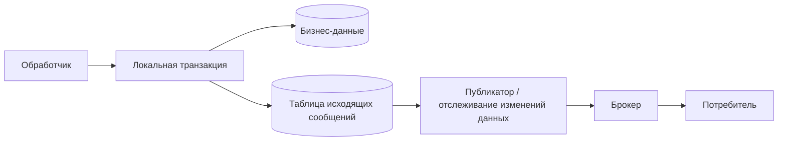

# Saga в промышленной эксплуатации

10 минут · Надёжность между локальными транзакциями

<!--
Время: 0:30. Мы уже выбрали способ координации. Теперь разберём гарантии, которые нужны обоим подходам. Эти десять минут — карта рисков, а не готовая реализация платёжной системы.
-->

---

# Истечение срока ожидания — неизвестный исход

- Запрос мог не дойти. Или операция выполнилась, а ответ потерялся.
- Ошибка превышения срока ожидания описывает ожидание клиента, не состояние платежа.
- Сохраняем «Исход платежа неизвестен»; запрашиваем статус или повторяем с тем же ключом.
- Только подтверждённый бизнес-отказ разрешает ветку отказа.

> Истёкший срок ожидания не отменяет уже совершённый внешний эффект.

<!--
Время: 1:30. В Go отмена context передаёт сигнал прекратить работу, но не является распределённым откатом. Отличать отказ банка от 502/обрыва соединения. Если провайдер не умеет ни дедупликацию, ни поиск операции по нашему идентификатору, безопасный автоматический повтор не гарантирован: нужна сверка или ручное разрешение. Бесконечное ожидание также не политика: задаём бизнес-дедлайн и эскалацию.
-->

---

# Повтор доставки — нормальный сценарий

- При доставке **хотя бы один раз** одно сообщение может прийти несколько раз.
- Идентификатор сообщения — дедупликация доставки; идентификатор Saga — связь процесса.
- Ключ операции стабилен между попытками, но различается между шагами.
- Один ключ + другое содержимое → конфликт, а не новая авторизация.

```go
// Контракт команды; ключ генерируется один раз и сохраняется.
type AuthorizePayment struct {
    SagaID         string
    IdempotencyKey string // например, order-42/payment/authorize/v1
    AmountMinor    int64  // сумма в минимальных денежных единицах
    Currency       string
}
```

<!--
Время: 2:00. Это учебный Go-тип сообщения. Нельзя генерировать UUID при каждой попытке вызова. Payment сохраняет ключ, параметры и результат под уникальным ограничением; параллельные дубли сериализуются. Если внутри есть внешний провайдер, локальная таблица ключей не закрывает окно «провайдер выполнил, мы упали»: передаём стабильный ключ провайдеру и сверяем статус. Хранить дедупликацию нужно не меньше горизонта повторов; TTL провайдера может быть короче жизни Saga. Компенсация имеет собственный стабильный ключ. Вопрос на 30 секунд: одинаковы ли ключи AuthorizePayment и VoidAuthorization? Нет, это разные операции; стабильность нужна между попытками каждой из них. Отсылка: https://docs.stripe.com/api/idempotent_requests
-->

---
layout: diagram
---

# Вместо двух записей — таблица исходящих сообщений



::caption::
Изменение данных и запись в таблицу исходящих сообщений — одна фиксация транзакции. Публикация — позже.

<!--
Время: 2:30. Без outbox падение после commit до publish оставляет бизнес-изменение без события. Обратный порядок допускает событие о незакоммиченном изменении. В одной БД атомарно меняем бизнес-строку и добавляем outbox. Relay публикует и помечает запись отправленной только после подтверждения брокера. Падение между publish и отметкой порождает дубль: exactly-once не появилось. Потребитель фиксирует inbox/message_id и свой эффект одной локальной транзакцией. Внешний API требует отдельной идемпотентности. Сохраняем порядок для конкретного процесса через sequence/version, не предполагаем глобальный порядок брокера. Вопрос на 30 секунд: можно ли пометить запись отправленной до publish? Нет, при падении потеряем публикацию. Источник: https://microservices.io/patterns/data/transactional-outbox.html
-->

---

# Перезапуск — продолжение, не новая Saga

- Храним состояние, версию, результат шага и идентификаторы ресурсов.
- Переход состояния + следующая команда в таблице исходящих сообщений — атомарно.
- Предельные сроки и время следующей попытки переживают остановку процесса.
- CAS по версии / блокировка не дают двум обработчикам сделать разные переходы.
- Поздние и повторные ответы проверяем по операции и текущему состоянию.

<!--
Время: 2:00. После рестарта воркер подбирает незавершённые Saga и просроченные таймеры из durable store. Если команда была отправлена, но результат не зафиксирован, мы не знаем исход — повтор/сверка со стабильным ключом. Lease помогает распределять работу, но истёкшая lease не останавливает старого воркера: нужен контроль версии/fencing в хранилище и идемпотентность внешних эффектов. Изменение кода требует совместимости с сохранённой версией workflow. HTTP-вызов не держим внутри долгой транзакции БД. Вопрос на 30 секунд: что делать с таймером, истёкшим во время простоя? После восстановления обработать сохранённый дедлайн с проверкой текущей версии состояния.
-->

---

# Компенсация тоже может упасть

- «Компенсация» — рабочее состояние, ещё не «Отменён».
- Временная ошибка → ограниченные повторы с растущей задержкой и случайным разбросом.
- Постоянная ошибка / исчерпан бюджет → «Требует внимания» и ответственный.
- Метрики: возраст Saga, неизвестные исходы, зависшие компенсации, задержка исходящих сообщений.
- Журналы и трассировки связываем через идентификатор Saga, шаг, попытку и результат.

<!--
Время: 1:30. Пример: void авторизации временно недоступен. Нельзя молча пометить заказ отменённым, оставив удержание средств без учёта. У разных шагов разные SLA. Истечение авторизации может оказаться эквивалентом void только после подтверждения состояния провайдера и по бизнес-правилам. Для ручной обработки сохраняем контекст, сигнализируем человеку и предоставляем безопасное возобновление. Не логируем платёжные секреты. Вопрос аудитории: какая метрика обнаружит процесс, от которого перестали приходить любые события? Ответ: возраст незавершённого состояния/дедлайн, а не только счётчик ошибок.
-->
