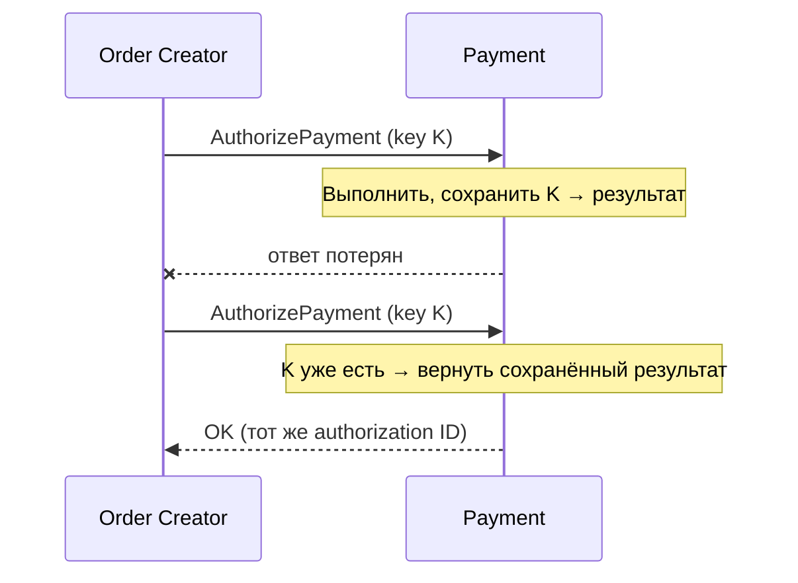
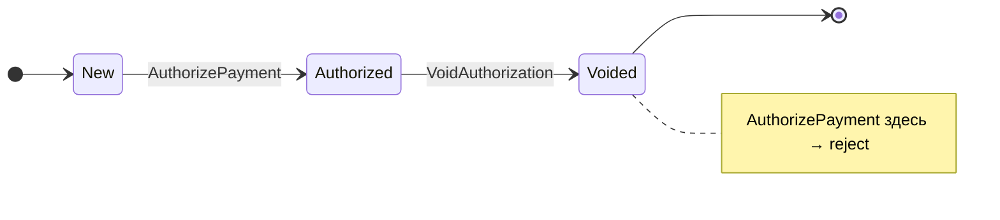
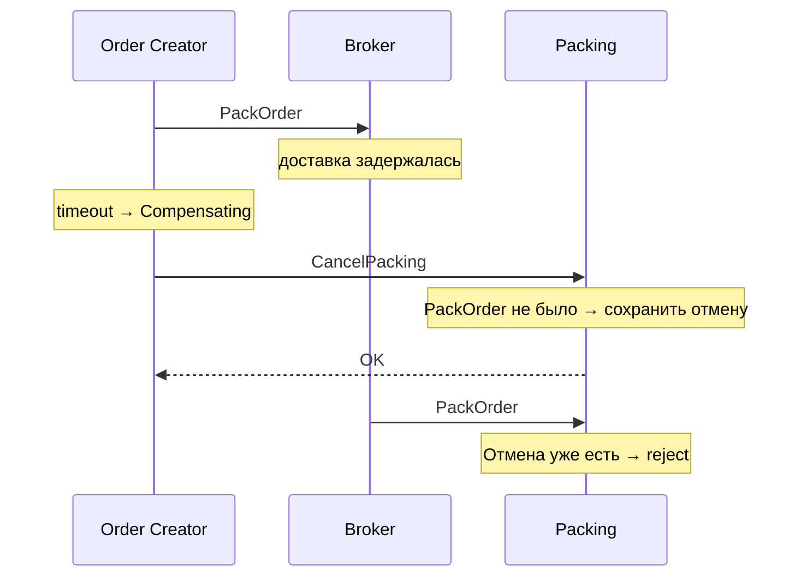

# Гарантии внутри сервиса

Чему должен соответствовать бизнес-процесс в каждом участнике Saga

---

# Что рассмотрим

- **Атомарность шага** — изменение состояния и outgoing message в одной транзакции
- **Idempotency** — повторная command или event не создаёт второй эффект
- **Допустимость перехода** — локальная state machine отклоняет устаревшие и неупорядоченные сообщения
- **Compensation** — idempotent, повторяема и корректна, даже если шаг не выполнялся
- **Отмена до выполнения** — сервис запоминает отмену и не выполняет шаг позже

---

# Атомарность шага

- Изменение данных и outgoing message фиксируются одним commit
- Падение не оставит «шаг без события» или «событие без шага»
- Обработка входящего сообщения и запись результата — тоже одна транзакция
- Реализация — Transactional Outbox, разберём в секции 8

---
layout: diagram
---

# Idempotency

::caption::
Повтор с тем же key возвращает прежний результат, а не создаёт второй эффект

---
layout: diagram
---

# Допустимость перехода

::caption::
Сервис проверяет текущее состояние: поздняя command не откатывает процесс назад

---

# Compensation

- **Idempotent** — повторный `VoidAuthorization` не меняет результат
- **Повторяема** — transient error → retry, пока не завершится
- **Корректна без шага** — authorization не было → ничего не делаем и отвечаем OK
- **Не стирает историю** — переводит запись в новое состояние, например Voided

---
layout: diagram
---

# Отмена до выполнения

::caption::
Без сохранённой отмены поздняя command выполнит шаг, который уже никто не компенсирует
