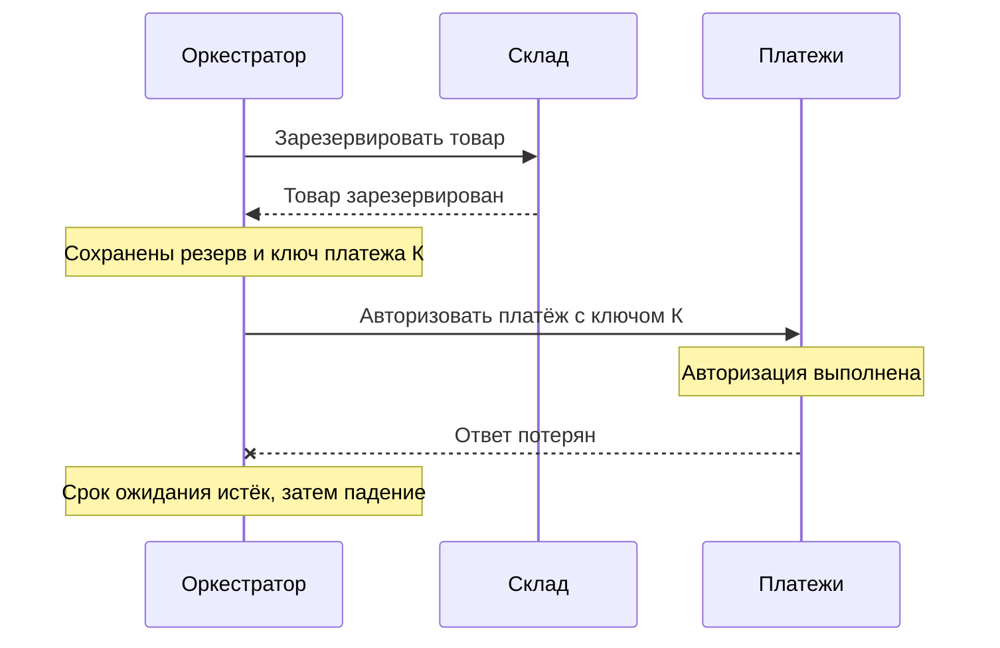

# Разбор сбоя

6 минут · Платёж есть, ответа нет

<!--
Время: 0:15. Предложить работать парами. Сначала восстановить факты, затем выбрать действие. Здесь нет нового механизма: проверяем, можем ли применить предыдущие разделы.
-->

---
layout: diagram
---

# Что мы знаем после падения?

::caption::
Снаружи мы знаем об авторизации. Восстановленный оркестратор — ещё нет.

<!--
Время: 1:00. Отличить знание преподавателя от знания программы. Даже запись timeout могла не успеть сохраниться: восстановление увидит либо PaymentPending, либо PaymentUnknown. В обоих случаях команда могла выполниться. В условии резерв уже подтверждён и записан, намерение авторизовать с ключом K сохранено до отправки. Внешний effect и локальная фиксация ответа не атомарны.
-->

---

# Ваш план восстановления

1. Что произойдёт при повторном вызове сервиса «Платежи»?
2. Что должно лежать в БД до отправки команды?
3. Когда продолжать доставку, а когда компенсировать?

> Отдельно рассмотрите: тот же ключ, новый ключ, API без ключей.

<!--
Время: 2:00. Дать 45 секунд парам и собрать 2–3 ответа. Ожидаем: тот же ключ при действующей гарантии провайдера возвращает прежний результат/статус и не создаёт второй эффект; новый ключ допускает вторую авторизацию. Без ключей повтор опасен, нужен поиск по merchant reference, сверка реестра или ручное вмешательство. Сохранить saga/order ID, состояние и версию, operation ID/ключ, неизменяемые сумму и валюту, reservation ID, дедлайн, попытку и next_attempt_at, outbox и известные результаты. После ответа — authorization ID. Восстанавливать только по stack trace или логам недостаточно.
-->

---

# Решение зависит от подтверждённого исхода

| Результат сверки в сервисе «Платежи» | Действие оркестратора |
| --- | --- |
| Авторизован, заказ ещё актуален | Сохранить идентификатор авторизации → бронировать доставку |
| Авторизован, предельный срок заказа истёк | Отмена авторизации → освободить резерв → отменить заказ |
| Платёж достоверно отклонён | Освободить резерв → отменить заказ |
| Всё ещё неизвестен / выполняется | Ждать, сверять, повторять безопасно; затем эскалация |

<!--
Время: 1:45. Истечение бизнес-дедлайна означает решение отказаться от заказа, но не доказательство отсутствия платежа. При неизвестном исходе фиксируем намерение отменить и продолжаем reconciliation; поздняя авторизация должна привести к void, а не к бронированию доставки. «Not found» безопасно считать отсутствием операции только по контракту API: исходный запрос может ещё выполняться. Проверить срок резерва и авторизации перед продолжением. Не слать слепо void и authorize одновременно: контракт участника должен исключить позднюю авторизацию после завершённой отмены или обеспечить последующую сверку. Отсутствие API для разрешения неопределённости — реальное ограничение автоматизации.
-->

---

# Инварианты после восстановления

- Повтор шага сохраняет ключ и параметры исходной операции.
- В состояние «Подтверждён» переходим только с действующими резервом, оплатой и доставкой.
- При отмене учитываем и поздно обнаруженную авторизацию.
- Пока исход или компенсация неизвестны — Saga не завершена.

<!--
Время: 1:00. Попросить назвать проверку в fault-injection тесте: провайдер выполнил операцию, ответ потерян, воркер перезапущен; эффект авторизации один, процесс либо продолжился, либо корректно компенсирован. Другой важный сценарий — поздний успешный ответ после решения отменить. Не требуем полного отсутствия повторных HTTP-вызовов: требуем отсутствия повторного бизнес-эффекта. Это критерии реальной реализации, не обещание exactly-once транспорта.
-->
