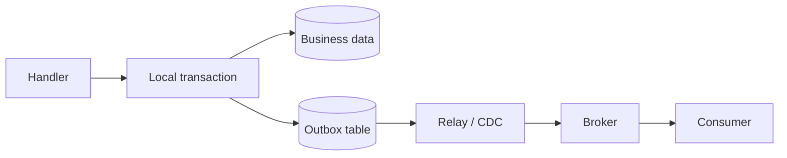

# Saga в production

Надёжность между локальными транзакциями

---

# Timeout — неизвестный исход

- Запрос мог не дойти. Или операция выполнилась, а ответ потерялся.
- Timeout error описывает ожидание клиента, не состояние платежа.
- Сохраняем PaymentUnknown; запрашиваем статус или retry с тем же idempotency key.
- Только подтверждённый бизнес-отказ разрешает ветку отказа.

> Timeout не отменяет уже совершённый внешний эффект.

---

# Redelivery — нормальный сценарий

- При **at-least-once** delivery одно сообщение может прийти несколько раз.
- Message ID — deduplication доставки; Saga ID — связь процесса.
- Idempotency key стабилен между попытками, но различается между шагами.
- Тот же key + другой payload → конфликт, а не новая authorization.

```go
// Контракт команды; ключ генерируется один раз и сохраняется.
type AuthorizePayment struct {
    SagaID         string
    IdempotencyKey string // например, order-42/payment/authorize/v1
    AmountMinor    int64  // сумма в минимальных денежных единицах
    Currency       string
}
```

---
layout: diagram
---

# Вместо dual write — Transactional Outbox



::caption::
Изменение данных и запись в outbox — один commit. Публикация — позже.

---

# Restart — продолжение, не новая Saga

- Храним состояние, версию, результат шага и resource IDs.
- State transition + следующая command в outbox — атомарно.
- Deadlines и next_attempt_at переживают остановку процесса.
- CAS по версии / lock не дают двум workers сделать разные transitions.
- Late и duplicate ответы проверяем по операции и текущему состоянию.

---

# Compensation тоже может упасть

- Compensating — рабочее состояние, ещё не Cancelled.
- Transient error → ограниченные retries с exponential backoff и jitter.
- Permanent error / исчерпан retry budget → NeedsAttention и ответственный.
- Метрики: возраст Saga, неизвестные исходы, stuck compensations, outbox lag.
- Logs и traces связываем через Saga ID, шаг, попытку и результат.
