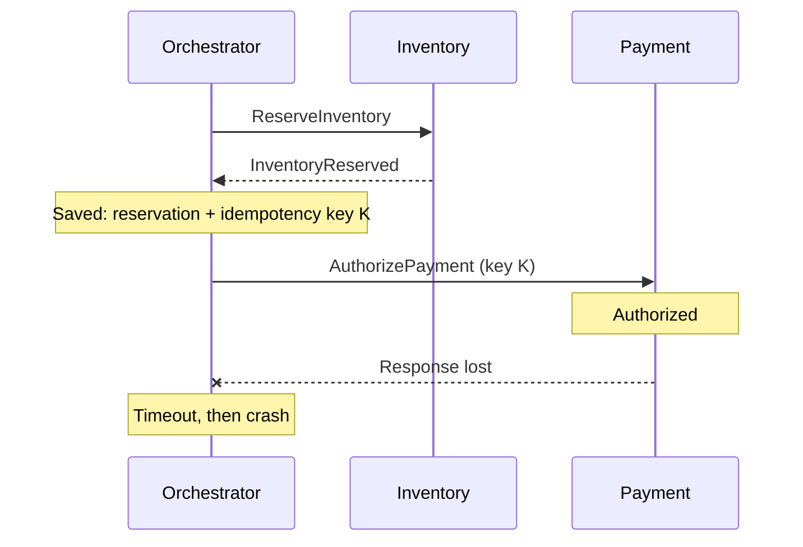

# Разбор сбоя

Платёж есть, ответа нет

---
layout: diagram
---

# Что мы знаем после падения?

::caption::
Снаружи мы знаем об authorization. Восстановленный orchestrator — ещё нет.

---

# Ваш план восстановления

1. Что произойдёт при повторном вызове Payment?
2. Что должно лежать в БД до отправки command?
3. Когда продолжать доставку, а когда компенсировать?

> Отдельно рассмотрите: тот же key, новый key, API без idempotency keys.

---

# Решение зависит от подтверждённого исхода

| Результат reconciliation в Payment | Действие orchestrator |
| --- | --- |
| Authorized, заказ ещё актуален | Сохранить authorization ID → BookDelivery |
| Authorized, deadline заказа истёк | VoidAuthorization → ReleaseInventory → CancelOrder |
| PaymentFailed (достоверный отказ) | ReleaseInventory → CancelOrder |
| Всё ещё Unknown / Pending | Ждать, reconciliation, безопасный retry; затем эскалация |

---

# Инварианты после восстановления

- Retry шага сохраняет idempotency key и параметры исходной операции.
- В Confirmed переходим только с действующими reservation, authorization и delivery booking.
- При отмене учитываем и поздно обнаруженную authorization.
- Пока исход или compensation неизвестны — Saga не завершена.
