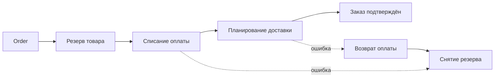
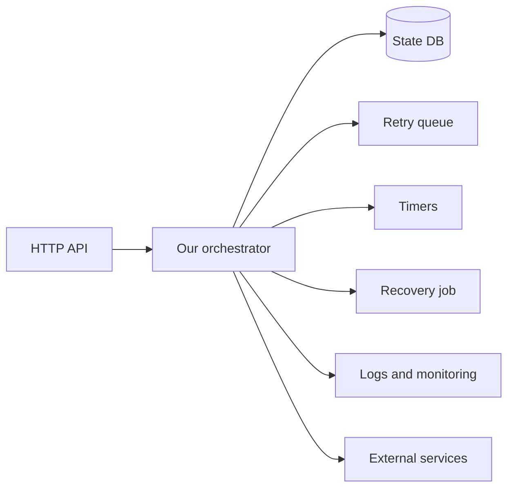

# От Saga к Temporal

Писать ли свой orchestrator?

---

# Напоминание: Saga и orchestration

- **Saga** — последовательность локальных транзакций; на каждый шаг есть compensating transaction.
- **Orchestration** — единый компонент (orchestrator) решает, какой шаг выполнить следующим и что делать при ошибке.
- Сервисы ничего не знают о процессе целиком: они выполняют команды orchestrator.

<!--
Коротко напоминаем материал прошлой лекции. Глобальной транзакции нет: каждый сервис коммитит своё локально, а при ошибке на следующем шаге уже выполненные шаги отменяются compensations. В orchestration вся логика процесса собрана в одном месте — это удобно для понимания и диагностики, но именно этот компонент теперь должен быть надёжным.
-->

---
layout: diagram
---

# Напоминание: Saga и orchestration

---

# Писать свой orchestrator?

На схеме всё просто: вызвать три сервиса по очереди, при ошибке — compensations.

**Сколько кода понадобится, чтобы это работало надёжно?**

> Последовательность вызовов — малая часть. Основная сложность — в механике надёжного выполнения.

<!--
Спросите аудиторию до ответа: кто писал бы такой orchestrator сам? Что произойдёт, если процесс упадёт после ChargePayment, но до ScheduleDelivery? Кто узнает, на каком шаге мы остановились? Что делать, если ответ платёжной системы потерялся, хотя деньги списались? Пусть студенты накидают список проблем — следующий слайд его структурирует.
-->

---

# Ключевые сложности самописного orchestrator

| Сложность | Что приходится строить |
|---|---|
| Процесс упал между шагами | Persistent state, запись статуса после каждого шага |
| Временные сбои сервисов | Retry с backoff, лимиты, разделение временных и бизнес-ошибок |
| Ожидание часами и днями | Durable timers и дедлайны, переживающие рестарт |
| Кто подхватит процесс | Recovery job, поиск «зависших» процессов |
| Несколько инстансов orchestrator | Блокировки/leases, защита от двойного исполнения шага |
| Ошибка в compensation | Retry compensations, статус для ручного вмешательства |
| Деплой при живых процессах | Совместимость нового кода со старым состоянием |
| Диагностика | История шагов, логи, метрики, поиск по процессам |

<!--
Самодельная orchestration обычно обрастает таблицами статусов, фоновыми job-процессами, очередями retry и ручными механизмами восстановления. Отдельно подчеркните «окно» между внешним вызовом и записью статуса: если упасть ровно там, после рестарта неизвестно, выполнен ли шаг, — значит, без idempotency не обойтись. Всё это можно написать, но сложность оказывается не в бизнес-логике заказа, а в инфраструктуре исполнения. Temporal позволяет отделить бизнес-последовательность от механизма исполнения.
-->

---
layout: diagram
---

# Цена самописного orchestrator

---

# Что даёт Temporal и чего не даёт

**Temporal предоставляет:** Durable Execution, Event History, управление задачами, retry, таймеры, восстановление и интерфейсы наблюдения.

**Разработчик всё ещё отвечает за:**

- Бизнес-последовательность шагов.
- Idempotency внешних эффектов.
- Compensations и их семантику.
- Согласованность бизнес-данных и эксплуатацию сервисов.

> Temporal = инфраструктура исполнения Workflow; Saga = бизнес-паттерн, реализованный поверх неё.

<!--
Это не «распределённая база данных» и не two-phase commit. Temporal не превращает HTTP-запросы к нескольким сервисам в атомарную транзакцию. Если оплату нужно компенсировать, мы сами пишем RefundPayment. Temporal обеспечивает надёжный вызов наших действий и запоминает ход выполнения. Именно это разграничение следует удерживать на протяжении всего занятия.
-->
