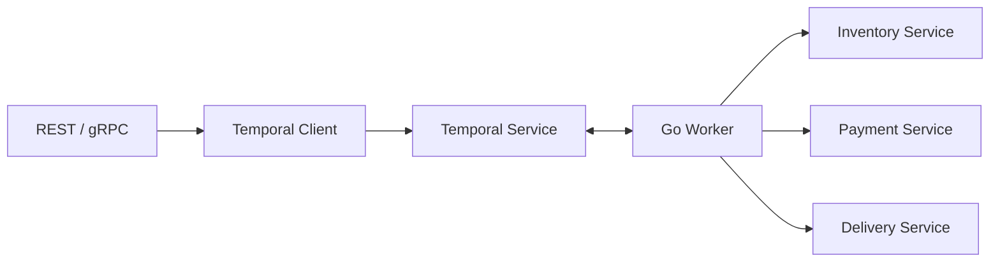

# Основные концепции Temporal

Словарь, который понадобится дальше

---

# Словарь Temporal

| Понятие | Что означает |
|---|---|
| Workflow Definition | Код orchestration: **как** исполняется процесс |
| Workflow Execution | Один конкретный экземпляр процесса |
| Activity | Код внешнего действия (HTTP, SQL, RPC) |
| Worker | Наш Go-процесс, который исполняет Workflow/Activities |
| Temporal Service | Управляет историями, заданиями и состоянием |
| Task Queue | Логическая очередь задач для Workers |
| Client | Запускает и управляет Workflow Execution |

<!--
Важно не смешивать Temporal Server и Worker. Код бизнеса исполняется не «на сервере Temporal»: его исполняют наши Workers. Сервер хранит историю и координирует выдачу заданий. Task Queue не означает, что мы обязаны поднимать Kafka или RabbitMQ. Это абстракция Temporal. Worker выбирает задания из нужной очереди через long polling.
-->

---

# Один Workflow — множество Executions (выполнений)

```go
// Workflow Definition: обычная Go-функция с особыми ограничениями.
func OrderWorkflow(ctx workflow.Context, req OrderRequest) error {
    // ... orchestration ...
    return nil
}
```

- `order-1001` и `order-1002` — разные Workflow Executions.
- **Workflow ID** — стабильный бизнес-идентификатор исполнения.
- **Run ID** — конкретный запуск/отрезок жизненного цикла исполнения.
- **Namespace** — граница разделения ресурсов Temporal.

<!--
Нередко Workflow ID делают равным order:<id>, чтобы API мог работать с бизнес-сущностью, не храня дополнительный технический UUID. Run ID меняется в сценариях нового запуска, Retry или Continue-As-New. Для большинства пользовательских операций достаточно Workflow ID; Run ID требуется при конкретной диагностике. При настройке повторных стартов одного Workflow ID нужно продумать reuse/conflict policies.
-->

---

# Activity — обычная Go-функция с внешним I/O

```go
// Зависимости (HTTP-клиенты, БД) — поля структуры, регистрируются в Worker.
type Activities struct {
    PaymentClient *payment.Client
}

func (a *Activities) ChargePayment(ctx context.Context, req OrderRequest) error {
    attempt := activity.GetInfo(ctx).Attempt
    activity.GetLogger(ctx).Info("charge payment", "orderId", req.OrderID, "attempt", attempt)
    return a.PaymentClient.Charge(ctx, req.OrderID, req.Amount, req.OrderID+":charge")
}
```

- Обычный `context.Context`: можно ходить в сеть, БД, читать `time.Now()`.
- Вход и результат сериализуются в Event History → только сериализуемые типы.
- `error` → Temporal повторит Activity по Retry Policy.
- Может выполниться **несколько раз** → idempotency key для внешнего эффекта.

<!--
Activity — противоположность Workflow: здесь нет ограничений детерминизма, это обычный Go-код. Методы структуры удобны тем, что зависимости (клиенты сервисов, пул соединений) создаются один раз при старте Worker и передаются через поля, а не через глобальные переменные. Имя Activity по умолчанию — имя метода, именно его мы потом передаём в ExecuteActivity.

Обратите внимание на последний аргумент Charge: стабильный ключ orderId:charge. Он одинаков для всех попыток, поэтому платёжная система может распознать повтор и не списать деньги дважды. Attempt из activity.GetInfo полезен в логах, чтобы видеть, какая это попытка. Подробно retry и классификацию ошибок разберём в блоке 7.
-->

---

# Workflow vs Activity: строгая граница

| Workflow | Activity |
|---|---|
| Определяет порядок и состояние | Делает реальную работу |
| Требует детерминизма | Может вызывать HTTP/БД |
| Использует `workflow.Context` | Использует `context.Context` |
| Replay по Event History | Может заново исполниться при Retry |

```go
// Workflow: корректный вызов внешнего действия
err := workflow.ExecuteActivity(ctx, "ChargePayment", req).Get(ctx, nil)

// Activity: реальный внешний I/O
func (a *Activities) ChargePayment(ctx context.Context, req OrderRequest) error {
    return a.callService(ctx, "charge", req)
}
```

<!--
Строка ExecuteActivity внутри Workflow не осуществляет HTTP-вызов. Она создаёт команду для Temporal, который назначит Activity Task Worker. Функция Activity — обычный Go-код и может использовать стандартную библиотеку, БД и сетевые клиенты. Код Workflow нельзя рассматривать как произвольный main со всеми возможностями Go: для выполнения по истории он подчиняется ограничениям детерминизма.
-->

---
layout: diagram
---

# Сопоставление с привычными компонентами



<!--
Temporal не заставляет переносить всю бизнес-логику в один сервис. В примере Order Worker — интеграционный/orchestration-компонент, а Inventory, Payment и Delivery живут по-прежнему в собственных сервисах. Нельзя незаметно заменить распределённую архитектуру монолитом только потому, что Workflow записан в одной Go-функции.
-->

---

# Сопоставление с привычными компонентами

- REST/gRPC API отвечает за приём команды пользователя.
- Client запускает Workflow **асинхронно** и получает ID.
- Worker — отдельный долгоживущий процесс или deployment.
- Сервисы остаются независимыми и владеют своими БД.
