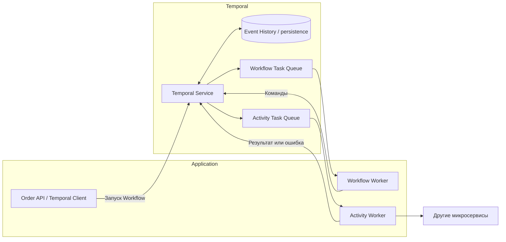
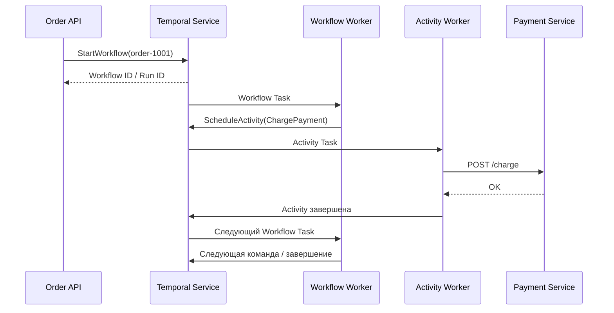
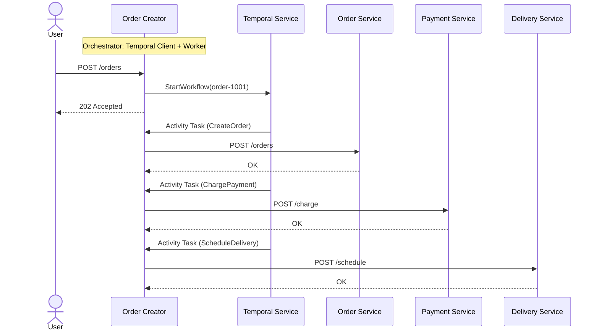

# Архитектура и жизненный цикл

Кто хранит, кто исполняет

---
layout: diagram
---

# Архитектура исполнения



<!--
Workflow и Activity Workers могут работать в одном Go-процессе и использовать одну Task Queue, как в демо, а могут быть разведены. На картинке очереди показаны логически. Temporal Service хранит историю; Worker периодически получает задания, выполняет код и отправляет результаты. Он не держит процесс заказа постоянно в памяти на протяжении всего времени ожидания.
-->

---
layout: diagram
---

# Что происходит при старте Workflow



<!--
Обратите внимание на асинхронность: успешный ответ на StartWorkflow означает, что Temporal принял запуск, а не что оплата прошла. Сразу возвращать HTTP 200 с «заказ оплачен» было бы некорректно. REST API обычно отдаёт 202 Accepted с ID операции и позволяет позже запросить состояние.
-->

---
layout: diagram
---

# Как это выглядит в нашей системе



<!--
Тот же сценарий, но на сервисах учебного проекта. Запрос пользователя приходит в Order Creator — это orchestrator всего процесса. Он совмещает две роли: принимает HTTP-запрос и запускает Workflow через Temporal Client, а внутри него работает Worker, который исполняет Workflow и Activities. Пользователь сразу получает 202 Accepted: процесс принят, но ещё не завершён.

Order, Payment и Delivery ничего не знают о Temporal — это обычные HTTP-сервисы, которые вызываются из Activities. Сервисы не вызывают друг друга напрямую: вся последовательность шагов — в Workflow внутри Order Creator.

Для компактности опущены Workflow Tasks и сообщения «Activity completed»: после каждого ответа сервиса Worker сообщает результат в Temporal Service, получает Workflow Task и решает, какой шаг следующий.
-->

---

# Что записывается в Event History

<div class="grid grid-cols-2 gap-12">
<div>

```text
WorkflowExecutionStarted
WorkflowTaskScheduled / Started / Completed
ActivityTaskScheduled (ReserveInventory)
ActivityTaskStarted
ActivityTaskCompleted
ActivityTaskScheduled (ChargePayment)
ActivityTaskStarted
ActivityTaskCompleted
...
WorkflowExecutionCompleted
```

</div>
<div>

- Event History — источник истины для воспроизведения Workflow.
- История содержит команды, результаты, таймеры и принятые сообщения.
- **Не** храните здесь большие payload, секреты и лишние персональные данные.

</div>
</div>

<!--
Temporal записывает события жизненного цикла, а не снимок всего heap Go-программы. История может содержать входные параметры и результаты Activities, поэтому важно контролировать размер и содержимое сериализуемых объектов. Имена и точная последовательность событий могут различаться для разных режимов исполнения, а неуспешные retry-попытки не обязаны отображаться как отдельная запись для каждой попытки в Event History.
-->

---

# Workflow ≠ постоянно работающий процесс

- Workflow может ожидать часы без выделенного Go-потока на всё это время.
- Состояние восстанавливается из истории при следующем Workflow Task.
- Можно перезапускать Worker независимо от длительности бизнес-процесса.
- При этом для продвижения процесса **нужен доступный совместимый Worker**.

<!--
Сравните с time.Sleep(24 * time.Hour) в обычном обработчике HTTP: процесс должен быть жив. Temporal таймеры и сигналы живут в механизме исполнения. Сервис Temporal сохраняет ожидание, а Worker получает работу при необходимости. Если все Workers остановлены, внешний бизнес-процесс не продвигается, но его история не исчезает.
-->
