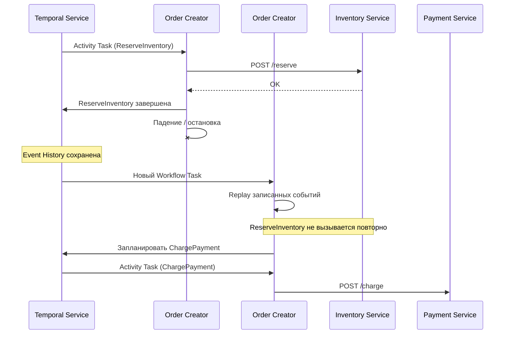
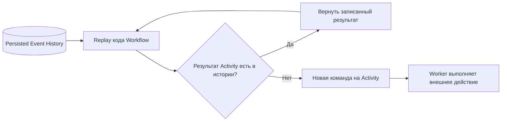

# Durable Execution и Replay

Что переживает падение Worker

---
layout: diagram
---

# Падение Worker: что восстанавливается

<!--
Спросите до ответа: что произойдёт после падения Worker? Что сохранилось? Ожидаемый тезис: Event History, не RAM.

На схеме — два инстанса Order Creator, нашего orchestrator. Первый успел зарезервировать товар в Inventory Service и упал. Temporal не делает дамп памяти и не перемещает живые горутины между машинами. Второй инстанс получает Workflow Task и воспроизводит Workflow-код по записанной истории. Для завершённой Activity SDK подставляет уже записанный результат. Но если Activity успела выполнить внешний эффект и умерла до подтверждения серверу, она может быть повторена. Это ключевой переход к idempotency, который разберём отдельно.
-->

---

# Падение Worker: что восстанавливается

- Восстанавливаются **решения Workflow**, а не Go-процесс.
- Завершённая Activity не вызывается повторно **из-за одного лишь Replay**.
- Незавершённая Activity после сбоя может быть выполнена ещё раз.

---
layout: diagram
---

# Replay: одна Go-функция, несколько запусков

<!--
Достаточно сказать: «Temporal умеет снова запустить бизнес-функцию и дойти до той же точки, не повторяя уже подтверждённые внешние вызовы». Именно поэтому нельзя случайным образом выбирать очередную Activity внутри Workflow. Детали внутренних механизмов кэша SDK здесь не нужны; важно различать replay и retry.
-->

---

# Replay: одна Go-функция, несколько запусков

- Replay — детерминированный пересчёт истории.
- SDK сопоставляет новые команды с событиями истории.
- Последовательность команд несовместима с историей → nondeterminism error.

---

# Детерминизм Go Workflow

| В обычном Go | В Workflow Go |
|---|---|
| `time.Now()` | `workflow.Now(ctx)` |
| `time.Sleep(d)` | `workflow.Sleep(ctx, d)` |
| `go f()` | `workflow.Go(ctx, f)` |
| `chan`/`select` | `workflow.Channel`/`workflow.Selector` |
| `http.Get`, SQL | `workflow.ExecuteActivity(...)` |
| Случайное значение | Activity или `workflow.SideEffect` |

Не полагаться на порядок `range` по `map`, если от него зависит порядок команд.

<!--
Код может быть корректным Go и некорректным Temporal Workflow. Внутри Workflow допустимы обычные вычисления над данными, но недопустимы недетерминированные побочные эффекты. workflow.GetLogger(ctx) предпочтительнее fmt.Println: SDK подавляет дубликаты логов при Replay. Текущую дату и случайные ID следует получать из поддерживаемых SDK-примитивов.
-->

---

# Replay ≠ Retry: вопрос аудитории

**Сценарий:** `ChargePayment` отправил запрос, платёжная система списала деньги, затем Worker умер до записи успешного ответа в Temporal.

Что произойдёт?

<v-clicks>

A. Temporal гарантированно узнает об оплате и не сделает второй вызов.

B. Activity может повториться; внешняя сторона должна распознать повтор.

C. Temporal автоматически вызовет `RefundPayment`.

</v-clicks>

**Верный ответ: B.**

<!--
Попросите сформулировать предсказание до ответа: возможен ли второй HTTP-вызов? Ожидаемый тезис: да, требуется idempotency.

Надёжное выполнение процесса не означает exactly-once физического выполнения побочного эффекта. По отношению к внешнему API типична семантика at-least-once, поэтому нужна idempotency. API оплаты должен иметь уникальный бизнес-ключ, например order-1001:charge, и при повторном запросе возвращать тот же результат вместо второго списания. Temporal не вызовет compensation без нашей бизнес-логики.
-->
