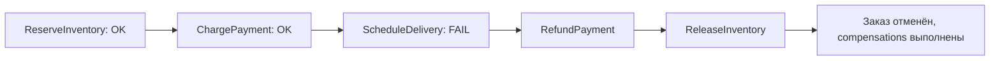
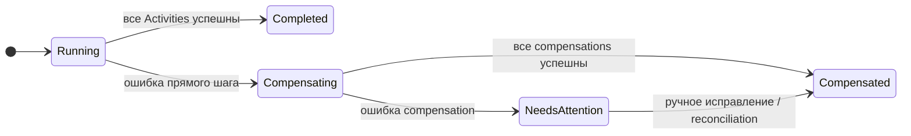

# Saga на Temporal

Forward-шаги и compensations в одном Workflow

---

# OrderWorkflow: прямой путь

```go
func OrderWorkflow(ctx workflow.Context, req OrderRequest) error {
    ctx = workflow.WithActivityOptions(ctx, activityOptions())
    if err := workflow.ExecuteActivity(ctx, "ReserveInventory", req).Get(ctx, nil); err != nil {
        return err
    }
    if err := workflow.ExecuteActivity(ctx, "ChargePayment", req).Get(ctx, nil); err != nil {
        return err
    }
    return workflow.ExecuteActivity(ctx, "ScheduleDelivery", req).Get(ctx, nil)
}
```

**Проблема:** при ошибке на третьем шаге два предыдущих эффекта уже выполнены.

<!--
Это реализация orchestration, но ещё не Saga с compensations. Успешные Activities не образуют общую транзакцию и не откатятся сами собой. Если ScheduleDelivery возвращает бизнес-ошибку, нужно решить, как компенсировать платёж и резерв. После этого показываем усложнение кода.
-->

---

# Compensation — отдельная бизнес-операция

| Forward Activity | Compensation Activity |
|---|---|
| `ReserveInventory` | `ReleaseInventory` |
| `ChargePayment` | `RefundPayment` |
| `ScheduleDelivery` | `CancelDelivery` |

- Compensations исполняются в **обратном порядке**.
- `RefundPayment` — не rollback БД, а новая транзакция.
- Compensations безопасны при повторе и при отсутствии эффекта.

<!--
Compensation — это доменное действие. Деньги могут вернуться спустя время, возврат может быть отклонён платёжной системой, отправленная посылка не всегда отменяется. Поэтому нельзя рисовать идеальную «обратную стрелку» как гарантию полного восстановления исходного мира. Порядок обратный, чтобы не нарушать зависимости: сначала разруливаем доставку/оплату, затем освобождаем резерв.
-->

---
layout: diagram
---

# Compensation — отдельная бизнес-операция



---

# Регистрируй compensation до рисковой Activity

```go
compensations = append(compensations, "RefundPayment")
err := workflow.ExecuteActivity(ctx, "ChargePayment", req).Get(ctx, nil)
if err != nil { return err }
```

**Почему до вызова?**

- Внешний эффект мог произойти, а ответ потеряться.
- Ошибка/timeout Activity не доказывает отсутствия эффекта.
- Compensation обязана корректно отвечать «нечего компенсировать».

<!--
Наивный код добавляет compensation в стек только после успешного Get(). Но между подтверждением эффекта и записью результата есть окно неопределённости. В практической реализации безопаснее заранее описать возможную compensation и сделать её идемпотентной: RefundPayment ищет исходный платёж по business ID и не делает ничего, если его нет. Такой контракт надо согласовать со внешним сервисом. Это не универсальное требование для всех доменов: иногда нужна reconciliation-операция, выясняющая факт эффекта.
-->

---

# Код Saga: запуск compensations

```go
// Фрагмент полной реализации из приложения A
func runCompensations(ctx workflow.Context, req OrderRequest,
    stack []string) error {

    cleanupCtx, cancel := workflow.NewDisconnectedContext(ctx)
    defer cancel()
    cleanupCtx = workflow.WithActivityOptions(cleanupCtx, compensationOptions)

    var failures []string
    for i := len(stack) - 1; i >= 0; i-- {
        if err := workflow.ExecuteActivity(cleanupCtx, stack[i], req).
            Get(cleanupCtx, nil); err != nil {
            failures = append(failures, fmt.Sprintf("%s: %v", stack[i], err))
        }
    }
    if len(failures) > 0 { return fmt.Errorf("rollback incomplete: %v", failures) }
    return nil
}
```

<!--
workflow.NewDisconnectedContext особенно важен при отмене исходного Workflow: контекст отменён, но бизнес-очистку выполнить всё ещё нужно. Фрагмент собирает ошибки и продолжает остальные compensations. Полный код приложения дополнительно логирует неуспешные шаги и сообщает о неполной компенсации. Также у compensations должны быть свои retry и timeout, отличающиеся от прямых Activities.
-->

---
layout: diagram
---

# Если compensation тоже упала



<!--
Один из главных operational-вопросов: что произойдёт, если при аварии Payment Service также не принимает refund? Можно делать retry, оставить процесс в ожидании, либо завершить его технической ошибкой и создать задачу операторам. В учебной версии при исчерпании retry Workflow завершится Failed, а подробность останется в error/log; в настоящем продукте нужно дополнительно иметь durable-механизм reconciliation и отдельный бизнес-статус.
-->

---

# Если compensation тоже упала

- Не скрывать ошибку compensation; сохранить причину.
- Повторять безопасные операции по ограниченной/управляемой политике.
- Для неразрешимых случаев — alert и ручное восстановление.
- Не путать **Workflow Failed** с бизнес-статусом «нужна проверка».

---

# «Нужна проверка» средствами Temporal

```go
statusKey := temporal.NewSearchAttributeKeyKeyword("BusinessStatus")
for {
    err := runCompensations(ctx, req, stack)
    if err == nil { return stepErr }

    state.Phase, state.LastError = "NEEDS_ATTENTION", err.Error() // видно через Query
    _ = workflow.UpsertTypedSearchAttributes(ctx, statusKey.ValueSet("NeedsAttention"))

    // Workflow остаётся Running и ждёт решения оператора.
    var decision string
    workflow.GetSignalChannel(ctx, "operator-decision").Receive(ctx, &decision)
    if decision == "resolved" { return stepErr }
    // decision == "retry" → повторяем compensations
}
```

- **Search Attribute** — найти все такие заказы: `BusinessStatus = 'NeedsAttention'`.
- **Query** `status` — причина ошибки без чтения логов.
- **Signal** от оператора — повторить compensations или закрыть вручную.

<!--
Вместо того чтобы завершать Workflow с ошибкой и терять контекст, оставляем его живым в состоянии «нужна проверка». Всё состояние — стек compensations, входные данные, причина — уже в Event History, поэтому повтор после исправления, например после восстановления Payment Service, запускается одной командой без ручной реконструкции.

Оператор находит такие заказы в Temporal UI или CLI: temporal workflow list --query "BusinessStatus = 'NeedsAttention'". Причину смотрит через Query, решение отправляет Signal: temporal workflow signal --workflow-id order-1001 --name operator-decision --input '"retry"'. Alert строится на метриках или на периодическом поиске по Search Attribute.

Signal, Query и Search Attributes подробно разберём в блоках 8 и 9 — здесь важна идея: «нужна проверка» — это бизнес-состояние живого Workflow, а не Failed. Search Attribute BusinessStatus нужно заранее создать в Namespace. Ожидание может длиться долго — следите за размером истории; при необходимости добавьте таймер с эскалацией.
-->

---

# Демо: ошибка доставки и обратный ход

<div class="grid grid-cols-2 gap-12">
<div>

```bash
go run ./cmd/start fail-delivery-1002
```

**В UI:** найти Activity failure, следующие compensation Activities и итоговый статус.

</div>
<div>

**Ожидаемый путь:**

```text
ReserveInventory  → OK
ChargePayment     → OK
ScheduleDelivery  → NON-RETRYABLE ERROR
RefundPayment     → OK
ReleaseInventory  → OK
OrderWorkflow     → Failed (с причиной)
```

</div>
</div>

<!--
Вопрос в аудиторию: кто делает refund? Ожидаемый тезис: наша compensation Activity.

Префикс fail-delivery- — условие в mock-сервисах приложения. Обсудите, почему в бизнес-системе «отказ в доставке по этому адресу» не нужно повторять через exponential backoff бесконечно. На успешной compensation Workflow всё равно может иметь технический статус Failed: это не ошибка демонстрации, а выбор контракта Workflow. Бизнес-статус «заказ отменён» может храниться отдельно.
-->
