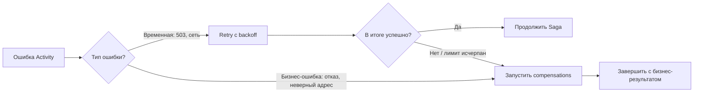

# Retry, timeout и ошибки

Повторить или компенсировать?

---
layout: diagram
---

# Retry и compensation — разные ветки



<!--
Если платёжная система отвечает 503, повторить попытку разумно. Если платёжная система однозначно отказала по недостатку средств, тот же запрос бессмысленно повторять немедленно. Наша Activity конвертирует такие ответы в типизированную non-retryable ошибку. Как именно классифицировать ошибки — часть доменной политики, а не встроенное знание Temporal.
-->

---

# Retry и compensation — разные ветки

- Технический сбой → обычно retry.
- Бизнес-отказ → обычно non-retryable + compensation.
- Retry Policy ≠ решение о бизнес-откате.

---

# Настройка Retry Policy на Go

```go
opts := workflow.ActivityOptions{
    StartToCloseTimeout:    10 * time.Second,
    ScheduleToCloseTimeout: 45 * time.Second,
    RetryPolicy: &temporal.RetryPolicy{
        InitialInterval:    time.Second,
        BackoffCoefficient: 2,
        MaximumInterval:    10 * time.Second,
        MaximumAttempts:    3,
    },
}
ctx = workflow.WithActivityOptions(ctx, opts)
```

- По умолчанию Activities имеют retry-поведение.
- `MaximumAttempts: 0` означает отсутствие ограничения по числу попыток.
- Workflow Execution по умолчанию **не** получает retry-policy автоматически.

<!--
Для лекционного демо используем небольшой budget, чтобы быстро увидеть compensation. В production количество попыток и общий лимит времени выбираются по SLA внешней системы. ScheduleToCloseTimeout ограничивает всё время исполнения Activity включая ожидание и retry, а StartToCloseTimeout — отдельную попытку. Эти значения должны быть согласованы с таймаутом HTTP-клиента.
-->

---

# Timeouts: не все одинаковы

| Timeout | За что отвечает |
|---|---|
| `ScheduleToStart` | Ожидание Activity Task до выдачи Worker |
| `StartToClose` | Одна попытка Activity |
| `ScheduleToClose` | Всё время Activity с retries и ожиданием |
| `Heartbeat` | Максимальный интервал между heartbeat у долгой Activity |

```go
func LongImport(ctx context.Context, input ImportRequest) error {
    for i := 0; i < input.Chunks; i++ {
        if err := processChunk(ctx, i); err != nil { return err }
        activity.RecordHeartbeat(ctx, i)
    }
    return nil
}
```

<!--
Timeout не обязательно останавливает физически выполняющуюся работу во внешней системе. Если уже отправлен HTTP-запрос, результат может прийти позже или выполнить эффект даже после таймаута у вызывающего Worker. Для долгих процессов heartbeat нужен, чтобы быстрее обнаружить потерю исполнителя и передавать progress; при этом Activity должна уважать отмену context.Context. ScheduleToStart часто используют для диагностики и capacity, а не как универсальный business timeout.
-->

---

# Демо: временный сбой и idempotency

```bash
go run ./cmd/start retry-payment-1003
```

- Mock Payment на **первой** попытке отдаёт `503`.
- Temporal повторяет `ChargePayment` по Retry Policy.
- После успеха Saga продолжает доставку.
- Заголовок `Idempotency-Key: <orderId>:charge` сохраняется для всех попыток.

<!--
Вопрос в аудиторию: это replay или retry? Ожидаемый тезис: retry Activity.

Покажите в логах mock-сервиса две попытки /charge. Затем в Temporal UI найдите Activity и сведения о попытках. Не требуйте, чтобы каждое retry-исполнение обязательно выглядело как отдельный ActivityTaskFailed в Event History: фактическое представление зависит от механизма retry и версии UI. После этого спросите, чем отличается «повторить HTTP-запрос» от «повторить Go Workflow-код».
-->
