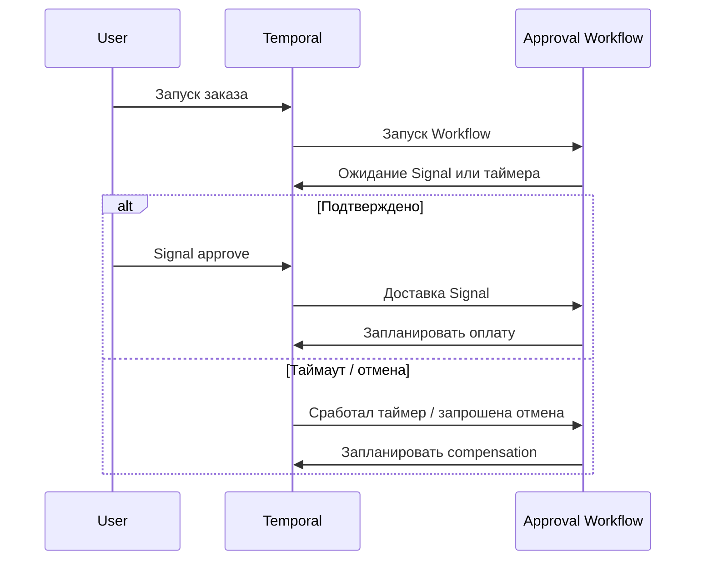

# Взаимодействие с работающим Workflow

Signal, Query, Update, таймеры и отмена

---

# Workflow как долгоживущий stateful endpoint

| Механизм | Для чего | Ожидаемый ответ |
|---|---|---|
| **Signal** | Сообщить event / решение | Подтверждение доставки сообщения, не итог бизнес-обработки |
| **Query** | Прочитать состояние | Снимок значения без мутации |
| **Update** | Изменить состояние, получить результат | Результат/ошибка обработчика с выбранной стадией ожидания |

**Пример:** заказ ожидает подтверждения клиента перед списанием.

<!--
Workflow — не HTTP-сервис, но внешне очень похож на stateful endpoint. Signal хорош для «пользователь нажал подтвердить», Query — для «какая текущая фаза?», Update — для действия, где требуется обработанный и валидированный результат. Query не должна мутировать состояние или вызывать Activities. Для Update важно различать принятие запроса и завершение его обработки.
-->

---

# Signal и ожидание event на Go

```go
func ApprovalWorkflow(ctx workflow.Context, orderID string) error {
    approvalCh := workflow.GetSignalChannel(ctx, "approve")
    var approved bool
    approvalCh.Receive(ctx, &approved)
    if !approved { return temporal.NewNonRetryableApplicationError(
        "rejected by customer", "CUSTOMER_REJECTED", nil) }
    // Продолжить оплату через Activity.
    return nil
}
```

```go
err := c.SignalWorkflow(ctx, "approval:"+orderID, "", "approve", true)
```

<!--
Receive не блокирует выделенный Worker на дни. Если Worker упадёт, полученный Signal отразится в Event History, и Replay восстановит значение. Отдельно покажите, что сигнал посылается существующему Workflow Execution. Сценарии «создать или отправить сигнал» можно строить через Signal-With-Start, но здесь это дополнительная тема.
-->

---

# Query и Update: когда нужен ответ

```go
// Внутри Workflow — состояние и Query.
status := "WAITING_APPROVAL"
err := workflow.SetQueryHandler(ctx, "status", func() (string, error) {
    return status, nil
})

// Update: проверка команды и изменение состояния.
err = workflow.SetUpdateHandler(ctx, "set-priority",
    func(ctx workflow.Context, priority int) (string, error) {
        if priority < 1 || priority > 5 { return "", fmt.Errorf("invalid priority") }
        status = "PRIORITY_UPDATED"
        return status, nil
    })
```

<!--
Этот код — отдельный фрагмент, не замена OrderWorkflow из демопроекта. Handler Update здесь иллюстрирует синхронное изменение простого Workflow-состояния. В реальном приложении клиент должен выбрать стадию ожидания результата Update; после асинхронной работы и при конкуренции нескольких handlers нужны дополнительные правила синхронизации. Если операция может сработать дважды на уровне бизнес-эффекта, idempotency нужна и здесь.
-->

---
layout: diagram
---

# Таймеры, отмена и compensation



<!--
Отмена — это запрос к Workflow, а не атомарное удаление всех следов его работы. Часто нужно освободить товар или вернуть оплату. Если выполненные Activities должны быть компенсированы при отмене, orchestrator обязан содержать эту логику. Terminate — административная грубая остановка, не эквивалент бизнес-отмены. Обратите внимание на ограничения отмены уже начавшегося внешнего HTTP-запроса.
-->

---

# Таймеры, отмена и compensation

- `workflow.Sleep` / timer — ожидание без `time.Sleep`.
- **Cancel** позволяет Workflow обработать отмену; **Terminate** обрывает без пользовательского cleanup.
- Для compensation при отмене — `workflow.NewDisconnectedContext`.
