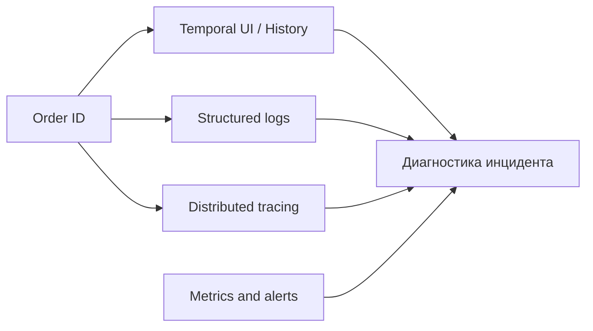
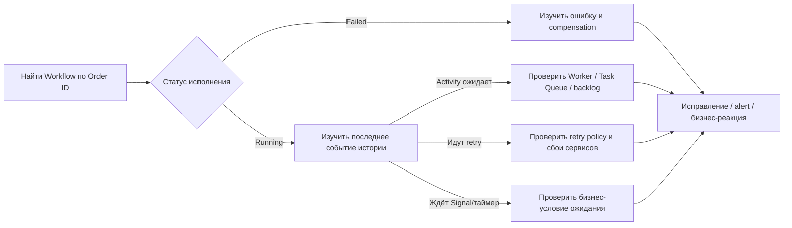

# Observability

Что случилось с заказом и почему

---

# Три вопроса observability

1. **Что случилось с заказом?** → Temporal UI / Workflow History / Search Attributes.
2. **Почему это случилось?** → Errors, логирование и trace между сервисами.
3. **Насколько проблема массовая?** → Метрики и алерты.

<!--
Observability нельзя сводить только к Web UI. UI помогает понять историю отдельного исполнения, но для массовой деградации нужны метрики. Логи помогают найти аргументы и ошибки, tracing показывает внешние RPC. Важно связывать три источника одним корреляционным ключом и при этом не складывать секреты или платежные данные в историю и логи.
-->

---
layout: diagram
---

# Три вопроса observability



---

# Temporal UI: куда смотреть при инциденте

**Алгоритм диагностики заказа:**

1. Найти Workflow по ID `order:<orderId>`.
2. Проверить `Running`, `Completed`, `Failed`, `Canceled`.
3. Открыть Event History / Activity details.
4. Посмотреть последние Activity, retry, timeout, failure.
5. Найти compensation-шаги и их результаты.

<!--
Вопрос в аудиторию: где найти причину failure? Ожидаемый тезис: Activity failure / история.

На demo fail-delivery-1002 найдите сбой ScheduleDelivery и последующие RefundPayment/ReleaseInventory. Если Workflow висит Running, проверяем, на какой Activity или таймере он ожидает. Если Worker не запущен, Task Queue не получает исполнителя. Сильная сторона Temporal — история конкретного экземпляра процесса доступна без ручного восстановления цепочки сообщений из логов пяти систем.
-->

---

# Search Attributes: операционный поиск

- Workflow ID — для точного поиска одного заказа.
- Search Attributes — для фильтра «все зависшие заказы».
- Примеры атрибутов: `OrderId`, `BusinessStatus`, `TenantId` (Keyword).
- Search Attributes должны быть созданы/разрешены в Namespace до записи.

```go
// Схематично: typed Search Attributes API Go SDK.
orderIDKey := temporal.NewSearchAttributeKeyKeyword("OrderId")
err := workflow.UpsertTypedSearchAttributes(
    ctx, orderIDKey.ValueSet(req.OrderID),
)
```

<!--
Search Attributes — не замена бизнес-БД и не инструмент синхронизации Workflow. Это индекс для поиска и операционной навигации, с особенностями индексации и eventual consistency. Для логики текущего Workflow нельзя полагаться на немедленную видимость свежего Search Attribute в глобальном поиске. Схема Search Attributes конфигурируется в соответствующем Namespace; имена в примере пользовательские, их нужно создать.
-->

---

# Логи, метрики и tracing

<div class="grid grid-cols-2 gap-12">
<div>

**Корреляция логов:** `orderId`, `workflowId`, `runId`, `activityType`, `attempt`.

```go
workflow.GetLogger(ctx).Info("phase changed",
    "phase", "PAYMENT")
// Внутри Activity:
info := activity.GetInfo(ctx)
activity.GetLogger(ctx).Info("call payment",
    "attempt", info.Attempt)
```

</div>
<div>

**Следим за метриками:**

- Workflow/Activity failures и latency.
- Schedule-to-start latency, очередь / backlog.
- Количество Worker pollers и доступность исполнителей.
- Количество заказов с длительной compensation (бизнес-метрика).

</div>
</div>

<!--
Используйте SDK-логгер для Workflow: он учитывает Replay. Для Activity полезны попытка, внешняя ошибка, длительность и correlation ID. Temporal SDK может экспортировать метрики, например для Prometheus/Grafana, а инструментация OpenTelemetry может расширить путь через микросервисы. Названия конкретных метрик и конфигурация экспортёров зависят от версии Temporal/SDK — для реального дашборда сверяйтесь со справочником metrics.
-->

---
layout: diagram
---

# Incident drill: заказ завис

Пользователь 15 минут видит «обрабатывается». Что проверяем?



<!--
Предложите группе несколько версий: «Payment не отвечает», «Worker нет», «ждём подтверждения», «compensation упала». За 60 секунд пусть назовут первое место, куда посмотрят, и какие факты будут там искать. Хороший ответ: начинать с конкретного Workflow ID и последних событий истории, затем переходить в метрики и логи зависимой системы.
-->
